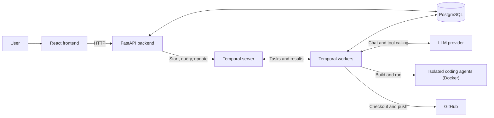

# Temporal project

A web application that turns a task described in conversation into requirements, an API design and verified code published to GitHub. A user picks a repository and branch, describes a task (a new service, an API change, a bugfix or a documentation change) and answers an LLM interviewer's questions. The application then records the requirements, designs the API where the task needs one, has separate coding agents write the service and its contract tests, verifies them against each other and pushes the result to a new branch of the repository. It also offers a free-form chat with the LLM and a list of workflow executions.

## Technology stack

- **Backend:** Python 3.12, FastAPI, in `backend/`.
- **Workflows:** Temporal, with several workers (main, codegen, implementation and test generation).
- **Storage:** PostgreSQL for application data and Temporal persistence; uploaded originals on disk.
- **Frontend:** React and TypeScript, built with Vite, in `frontend/`.
- **LLM access:** a LangGraph agent over a configured provider (for example an OpenAI-compatible endpoint or Google Gemini) and the Pi adapter; optional Langfuse tracing.
- **Coding agents:** run in isolated Docker containers.
- **Repository integration:** a shared GitHub App connection.
- **Deployment:** Docker Compose, including a Coolify deployment.

## Architecture

The browser talks to the FastAPI backend, which starts and queries Temporal workflows. Temporal workers run the workflows and activities, call the LLM provider, read and write documents in PostgreSQL and on disk, and start isolated Docker containers for the coding agents. Verified work is pushed to GitHub through the GitHub App.



See the [project interaction schema](docs/interaction-schema.md) for the detailed diagram.

## Quick start

### Locally

Start Temporal and PostgreSQL from the project root:

```sh
docker compose -f backend/docker-compose.yml up
```

Then install the backend dependencies and start a worker, the API and the frontend, as described in [frontend/README.md](frontend/README.md#start-locally). Set `AUTH_JWT_SECRET` (at least 32 characters) in `backend/.env` before signing in, and create the first account on the sign-in page.

### On Coolify

Deploy `docker-compose.coolify.yml`, configure the provider keys (`OPENAI_API_KEY` or `ANTHROPIC_API_KEY`) and `AUTH_JWT_SECRET` in Coolify, and create the first account before exposing the deployment. For ChatGPT OAuth models see [Pi OAuth in Coolify](docs/pi-oauth.md).

## Documentation

- [docs/asyncio.md](docs/asyncio.md): async execution.
- [docs/github-connector.md](docs/github-connector.md): the GitHub connector.
- [docs/interaction-schema.md](docs/interaction-schema.md): project interaction schema.
- [docs/langfuse-tracing.md](docs/langfuse-tracing.md): Langfuse tracing.
- [docs/pi-oauth.md](docs/pi-oauth.md): Pi OAuth in Coolify.
- [docs/service-implementation.md](docs/service-implementation.md): service implementation, tests and verification workers.
- [frontend/README.md](frontend/README.md): the web client, sign-in, model settings and local start.
- [backend/app/languages/java/test_suite/README.md](backend/app/languages/java/test_suite/README.md): Java service contract tests.
- [backend/app/languages/python/test_suite/README.md](backend/app/languages/python/test_suite/README.md): Python service contract tests.
