# Project interaction schema

Architecture of the current implementation. Arrows describe communication or data access, not deployment dependencies. Ports and task queues below are the local defaults.

## Architecture

```mermaid
flowchart LR
    user["User"]

    subgraph frontend["Frontend · React + TypeScript"]
        ui["Browser UI<br/>Chat · Requirements · API design · Workflows"]
        proxy["Vite development proxy<br/>/api/* → backend /*"]
    end

    subgraph backend["Backend · Python"]
        api["FastAPI · :8000<br/>Routes, validation, uploads, downloads"]
        services["Application services<br/>Conversations, requirements, API design<br/>Temporal client and execution listing"]
        docs["Document layer<br/>Storage, parsing, search, revisions, cleanup"]

        subgraph mainworker["Main Temporal worker · my-task-queue"]
            workflows["Workflows<br/>SayHello · LLMRequest<br/>Requirements · ApiDesign"]
            activities["Activities<br/>Parse attachments, answer turns<br/>Write requirements and OpenAPI"]
            agent["LangGraph agent<br/>Model ↔ tool-call loop"]
            tools["Tools<br/>Read/search/write documents<br/>Update requirements and API model"]
        end

        subgraph codeworker["Codegen Temporal worker · codegen"]
            codegen["CodegenWorkflow<br/>generate_server_code activity"]
            generator["Local Java subprocess<br/>OpenAPI Generator CLI<br/>registered language: interfaces + models + test stubs"]
        end

        subgraph implworker["Implementation worker · implementation"]
            impl["ImplementationWorkflow<br/>implement_service activity"]
        end

        subgraph testworker["Test generation worker · test-generation"]
            testgen["TestGenerationWorkflow<br/>generate_service_tests activity"]
        end
    end

    implagent["Isolated implementation container<br/>Generated interfaces + requirements → service"]
    testagent["Separate test container<br/>Requirements + API contract → JUnit HTTP tests"]

    subgraph infra["Infrastructure · Docker Compose"]
        temporal["Temporal server · :7233<br/>Scheduling, history, queries, updates"]
        temporalui["Temporal UI · :8080"]
        pg["PostgreSQL 16 · host :5433<br/>App schema + Temporal persistence<br/>Temporal visibility database"]
    end

    subgraph disk["Filesystem"]
        uploads["backend/data/documents<br/>Uploaded originals"]
        generated["backend/data/generated<br/>session-id/server, implementation, tests"]
    end

    provider["External LLM provider<br/>Google Gemini by default<br/>or OpenAI-compatible endpoint"]
    operator["Developer / operator"]

    user --> ui
    ui -->|"HTTP: submit, poll, download"| proxy
    proxy -->|"Strip /api prefix"| api
    api --> services
    api --> docs
    services -->|"Start, query, update, describe, list, history"| temporal
    services -->|"Load or copy session documents"| docs
    temporal <-->|"Worker polls tasks; returns results"| workflows
    workflows --> activities
    activities --> agent
    agent <-->|"Tool calls and results"| tools
    tools --> docs
    activities -->|"Parse / save documents"| docs
    agent <-->|"Chat and tool calling"| provider
    activities -->|"Requirements narrative"| provider
    workflows -->|"ApiDesign starts Codegen child via Temporal"| temporal
    temporal <-->|"Poll codegen queue; return result"| codegen
    codegen -->|"Read OpenAPI text"| docs
    codegen --> generator
    generator -->|"Write generated sources"| generated
    workflows -->|"After codegen: start implementation and tests in parallel"| temporal
    temporal <-->|"Poll implementation queue"| impl
    temporal <-->|"Poll test generation queue"| testgen
    generated -->|"Copy server sources; exclude tests"| impl
    impl -->|"Copy inputs; no host mounts"| implagent
    testgen -->|"Copy contracts only; no host mounts"| testagent
    implagent <-->|"Model and tools"| provider
    testagent <-->|"Model and tools"| provider
    impl -->|"Build service image; save sources/manifest"| generated
    testgen -->|"Build test image; save suite/manifest"| generated
    docs <-->|"Metadata, extracted/generated text, passages"| pg
    docs <-->|"Store/read/delete uploaded bytes"| uploads
    temporal <-->|"Persist history and visibility"| pg
    operator --> temporalui
    temporalui --> temporal
```

The main worker's workflows, activities, agent, and tools are logical modules within one worker process. Temporal delivers workflow and activity tasks; workers poll the configured queues rather than accepting direct calls from the API.

## Main interactions

| Interaction | Path through the system | Result |
| --- | --- | --- |
| Chat | Browser → API → Temporal → `LLMRequestWorkflow` → agent/provider/tools | Async answer; each reply gets a new workflow/request ID. Attachments are parsed before the model turn. |
| Requirements interview | Browser → API → Temporal updates → `RequirementsWorkflow` → agent | Long-running interview with structured requirements; finalization writes a Markdown document. |
| API design | Browser → API loads completed requirements → `ApiDesignWorkflow` → agent | Structured API model; finalization renders and stores OpenAPI YAML. |
| Code generation | `ApiDesignWorkflow` → `DeliveryWorkflow` → Temporal child workflow → codegen worker → local generator | Server code in the session's language, chosen during API design from the registry in `backend/app/languages/` (today Java: Spring interfaces, models, and disabled test stubs), written to disk. |
| Implementation and tests | After codegen, `DeliveryWorkflow` starts two child workflows on separate queues and Docker containers in parallel | Service image and independent JUnit HTTP test runner image; results/errors reported separately. Test authoring receives only requirements and API contracts. |
| Bugfix | `RequirementsWorkflow` → `DeliveryWorkflow`, with no API design or code generation | Regression tests, a baseline run that must fail only in them, the fix, then verification; see [service implementation](service-implementation.md#changing-an-existing-service-bugfix). |
| Repository checkout and push | `RequirementsWorkflow` / `ApiDesignWorkflow` check out, `DeliveryWorkflow` pushes → main worker → `git` → GitHub | Selected branch cloned before the first model turn; verified sources pushed to a new `generated/…` branch. |
| Retrieve / browse | Browser → API → Temporal queries, descriptions, history, or visibility listing | Session state, request status/results, and workflow listing. |
| Download document | Browser → API → document layer → PostgreSQL or upload directory | Uploaded original or generated document. |
| Operational monitoring | Operator → Temporal UI → Temporal server | Workflow history and execution inspection. |

## HTTP boundaries

The browser uses `/api` in front of these backend routes. Vite removes that prefix in development.

| Backend route | Purpose |
| --- | --- |
| `POST /llm/requests` | Start a chat turn; accepts JSON or multipart with one attachment. |
| `GET /llm/requests/{request_id}` | Poll status, conversation, and generated document metadata. |
| `POST /llm/requests/{request_id}/{retry,fork}` | Retry or branch a conversation. |
| `GET /llm/requests/{request_id}/documents/{document_id}` | Download an attachment or generated document. |
| `POST /requirements/sessions` | Start a requirements interview. |
| `POST /api-design/sessions` | Start API design from a completed requirements session. |
| `GET /{requirements,api-design}/sessions/{session_id}` | Retrieve session state. |
| `POST /{requirements,api-design}/sessions/{session_id}/{messages,retry,finalize,fork}` | Update, retry, finalize, or branch a session. |
| `GET /{requirements,api-design}/sessions/{session_id}/document` | Download the finalized document. |
| `GET /workflows` | List workflow executions with optional type filter and pagination. |
| `POST /start` | Run the greeting workflow and return its result. |

Brace notation groups routes for readability; it is not literal URL syntax.

## Storage and deployment notes

- **Temporal owns execution state:** transcripts, requirements/API state, activity results, and workflow history are retained through Temporal. The local namespace is configured with one-day retention.
- **PostgreSQL owns document data:** `app.documents` stores metadata, extracted upload text, generated text, and revisions; `app.session_passages` stores remembered retrieved passages. The default app connection uses the same PostgreSQL service/database as Temporal, but a separate `app` schema.
- **Uploaded bytes live on disk:** API and main worker must share `DOCUMENT_STORAGE_DIR` if deployed separately. The API cleans up expired documents hourly.
- **Repository checkouts live beside them:** `GENERATED_CODE_DIR/<session_id>/repository`, cloned and pushed by the main worker, which needs `git` and shares `GENERATED_CODE_DIR` with the coding workers.
- **Generated artifacts live on worker disks:** `GENERATED_CODE_DIR/<session_id>/server`, `implementation/service` and `tests/suite`. The two coding workers publish image manifests on their Docker daemon. There is no generated-code download route; service launch and test execution are separate steps. See [service and test workers](service-implementation.md).
- **The LLM provider is configurable:** the pure `app/llm/factory.py` selects the Google SDK for the Google endpoint, otherwise `ChatOpenAI`. `app/llm/model.py` supplies the cached host wrapper; isolated agents pass explicit environment settings to the same factory. Defaults live in `app/config.py`.
- **Compose runs infrastructure only:** PostgreSQL, Temporal, Temporal UI, and setup jobs. Frontend, API, main worker, codegen worker, implementation worker and test generation worker run separately. Production needs its own `/api` reverse proxy or equivalent routing; Vite's proxy is development-only.

## Source map

- Frontend screens: `frontend/src/main.tsx`, `App.tsx`, `Requirements.tsx`, `ApiDesign.tsx`, `Workflows.tsx`
- Development HTTP routing: `frontend/vite.config.ts`
- API boundary: `backend/app/api/main.py`, `backend/app/api/routes/`
- Application services: `backend/app/conversations/service.py`, `backend/app/requirements/service.py`, `backend/app/api_design/service.py`
- Main worker: `backend/app/temporal/worker.py`, `workflows.py`, `activities.py`
- Agent/provider/tools: `backend/app/llm/`, `backend/app/tools/`
- Documents/database: `backend/app/documents/`, `backend/app/db.py`
- Code generation: `backend/app/codegen/`
- Isolated coding workers/policies: `backend/app/implementation/`, `backend/app/test_generation/`
- Shared stage lifecycle/container runtime/bootstrap: `backend/app/agent_workflows/`
- Host Docker isolation and explicit agent image builds: `backend/app/docker_agents.py`
- Configuration/infrastructure: `backend/app/config.py`, `backend/docker-compose.yml`
