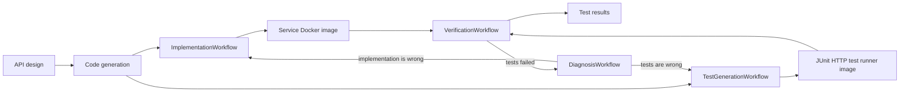
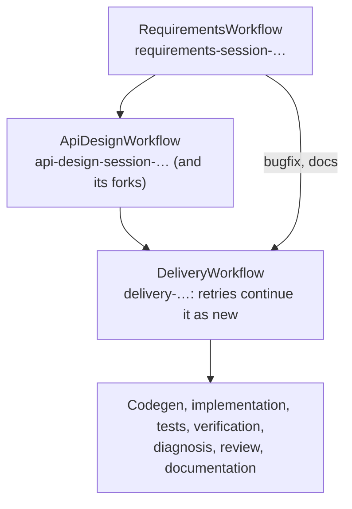
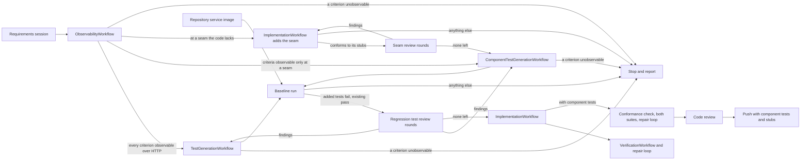
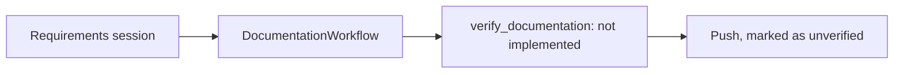

# Service implementation, tests and verification workers

The pipeline is API design → code generation → parallel implementation and test generation
→ verification against the running service.
Everything after the design is one `DeliveryWorkflow` (`backend/app/delivery/`), named
`delivery-<session-id>`. A finished API-design session starts it with a `TaskSpec`: the
requirements, API model, OpenAPI document, language and repository the session agreed on.
A bugfix skips the design and code generation and is delivered from its requirements
session instead; see [Changing an existing service](#changing-an-existing-service-bugfix).
An API change goes the whole way, starting from the contract its repository holds; see
[Changing an existing API](#changing-an-existing-api).
A documentation task has one author and no service, tests or check; see
[Changing documentation only](#changing-documentation-only).
The workflow class is in `backend/app/delivery/workflows.py`: its run, the pipeline of each
task kind and the retries. Its rounds are mixins in `backend/app/delivery/flow/`, all working
on the workflow's one `state`:

| Module | What it holds |
| --- | --- |
| `stages.py` | The implementation and test authors, their context and child workflow IDs |
| `change.py` | Routing, the seam and the stage reviews of a change |
| `baseline.py` | The baseline run of a change's tests and its correction rounds |
| `verification.py` | Verification, diagnosis and the repair rounds |
| `review.py` | Code review rounds, corrections and fix rounds from instructions |
| `publication.py` | The push and the pull request |
| `mention_rounds.py` | Mentions on the pull request and their fix rounds |
| `waiting.py` | Waiting for the user's decision or the end of the pull request |

The delivery keeps each stage's result or error in its own `DeliveryProgress`, which the
session GET endpoint merges into the session it reports. The design session stays open
until its delivery ends; see [One workflow tree per task](#one-workflow-tree-per-task).
After successful code generation the delivery starts `ImplementationWorkflow` and
`TestGenerationWorkflow` on separate task queues.
Both children start before either is awaited to completion. Each result becomes
available independently; failure in one branch does not cancel the other.
With a repository, the delivery first [records its tests](#the-snapshot-of-the-repositorys-tests).
`VerificationWorkflow` starts only after both authoring children succeed. Failed assertions are completed test
results, not workflow failures; failed builds skip verification. Failed tests start the
[repair loop](#automatic-repair-of-failed-tests): `DiagnosisWorkflow` decides whether the
implementation or the tests are wrong, that side's own workflow corrects it, and
verification runs again.



## Run

From `backend`, using the same environment/database settings as the existing workers:

```sh
python -m app.temporal.worker
python -m app.codegen.worker
python -m app.agent_workflows.worker
```

Run each command in a separate terminal/process. `backend/tools/dev_stack.py` launches
all three workers, and `.zed/debug.json` includes individual worker launch profiles.
`app.agent_workflows.worker` is the sandbox worker: one process that polls the task
queues of every sandboxed stage (routing, implementation, test generation, verification,
diagnosis, review and documentation), each with its own one-activity-at-a-time Temporal
`Worker`. The stage requirements below therefore all apply to that one process.
Both coding stages need the Docker CLI, a running Docker daemon and writable
`GENERATED_CODE_DIR`. The implementation worker also needs access to codegen's server
tree. The test worker uses only contract inputs and the static test-suite template of the
session's language (`backend/app/languages/<language>/test_suite`: Java's Maven/JUnit 5 or
Python's pytest template).
The verification worker also needs Docker and writable `GENERATED_CODE_DIR`, and must
use the same Docker daemon as both authoring workers: images are local immutable IDs,
not registry tags. It also builds the baseline image of a
[bugfix](#changing-an-existing-service-bugfix) from the session's checkout. `TEMPORAL_VERIFICATION_TASK_QUEUE` defaults to `verification`.
The diagnosis worker has the same Docker and `GENERATED_CODE_DIR` needs as the coding
workers and reads the published service, test suite and verification artifacts.
`TEMPORAL_DIAGNOSIS_TASK_QUEUE` defaults to `diagnosis`.
The routing worker of a [bugfix](#changing-an-existing-service-bugfix) has the same needs
and reads the session's checkout. When it checks a component contract it also builds an
image that installs the repository's dependencies, so its Docker daemon needs outbound
access then. `TEMPORAL_ROUTING_TASK_QUEUE` defaults to `routing`.
The author of a bugfix's component tests runs on its own queue,
`TEMPORAL_COMPONENT_TEST_GENERATION_TASK_QUEUE` (default `component-test-generation`), so
that it writes beside the contract tests' author. It needs what the test worker needs, plus
the session's checkout: the trusted runner it builds installs the repository's
dependencies, so its Docker daemon needs outbound access too.
The documentation worker needs Docker and `GENERATED_CODE_DIR` too, to run its author; it
builds no image of the output. `TEMPORAL_DOCUMENTATION_TASK_QUEUE` defaults to
`documentation`.

Choose each LLM workflow's adapter, model ID, and thinking level in the **Settings** tab
(`?mode=settings`). `GET /settings` returns the saved values and supported thinking
levels; `PUT /settings` validates and atomically saves the complete workflow map.
Settings are shared application-wide in PostgreSQL's `app.workflow_settings` table.
Startup seeds missing rows with the local Qwen model, OpenAI adapter, and model-default
thinking. Saved rows are preserved across restarts. The supported types are chat,
requirements (including its document overview), API design, implementation, test
generation, diagnosis, documentation, and review. Delivery, code generation and verification
have no model calls of their own.

Every host turn reloads its workflow's settings. Coding containers receive a validated
snapshot in `/workspace/llm-settings.json` at launch, including on a resumed run.
An agent already running keeps its snapshot. Pi receives `--thinking`, OpenAI receives
`reasoning_effort`, and Claude receives SDK thinking/effort options in both standalone
requests and native coding sessions. `default` leaves the provider's reasoning default
unchanged. Model support for individual thinking levels is provider-dependent.

Configure `OPENAI_API_KEY` and `OPENAI_BASE_URL` through the environment.
Loopback provider URLs are translated to `host.docker.internal` inside Docker; remote
URLs are preserved. `TEMPORAL_IMPLEMENTATION_TASK_QUEUE` defaults to `implementation`
and `TEMPORAL_TEST_GENERATION_TASK_QUEUE` defaults to `test-generation`. The containers
require outbound access to the LLM provider and Maven repositories.

Selecting the **Pi** adapter routes model calls through the Pi CLI: the host chat
uses the `pi` on its `PATH`, and the coding-agent image installs its own. Pi signs in with
the credentials in `PI_CREDENTIALS_DIR` (default: Pi's own `PI_CODING_AGENT_DIR`, else
`~/.pi/agent`). Host calls run Pi with that directory as its configuration directory, and
each coding container gets
that directory's `auth.json` mounted read-write, so a refreshed token is kept, and its
`models.json` read-only, inside a `containers/` subdirectory of it that all containers share
as their Pi directory. Pi locks `auth.json` through a lock directory beside it, so sharing
that directory lets parallel agents take turns refreshing an OAuth token instead of each
rotating it. The saved workflow settings select the model and thinking level.

Selecting the **Claude** adapter runs a native Claude Code session through the
Claude Agent SDK (`app/llm/claude.py`). The SDK bundles the CLI. Claude executes its own
model/tool loop and compacts its own context. The current flow's tools are real executable
tools on the in-process `flow` MCP server; Claude receives their actual results directly.
Its built-in tools, unrelated settings, skills and project context files remain disabled.
The application supplies conversation context as a prompt when starting a host turn and
appends follow-ups within that native session. There are no forged transcript rows,
placeholder tool results, bridge threads or forced single-turn handoffs to LangGraph.

Coding agents use the project as their stable working directory. Their native session
transcripts and plugin export state live beside the project in `.claude-native`, included
in the preserved workspace when a run pauses. `ask_user` stops native execution before
another model request. The next container resumes that native session ID and sends the
answers as a new user message. Completion and native turn limits still enforce the stage's
existing validation and failure behavior. A paused run must keep the Claude adapter when
resumed; pauses saved by the previous custom runner cannot be resumed by this version.

On the host Claude Code signs in with its own login, or with
`ANTHROPIC_API_KEY` / `CLAUDE_CODE_OAUTH_TOKEN` (from `claude setup-token`) when set. A
host login lives in the keychain or `~/.claude` and is not shared with containers: coding
agents require one of those variables (or `ANTHROPIC_AUTH_TOKEN`), which is forwarded by
name along with `ANTHROPIC_BASE_URL`.

## Langfuse tracing

See [Langfuse tracing](langfuse-tracing.md) for environment setup, privacy controls,
trace/session structure and the live smoke/audit command. Chat and design turns,
coding-agent generations/tools, codegen and verification are instrumented.
`backend/.env` is loaded for local development and never copied into agent images.

## Docker diagnostics

Worker logs now report Docker operation start/end, an operation ID, elapsed time and
exit status (including timeout/cancellation). Arguments and environment values are
not logged because they may contain credentials. Failure output tails are logged at
ERROR; successful output tails are available with `LOG_LEVEL=DEBUG`. Known provider
and environment secrets are redacted before output is returned, persisted or logged.

Each authoring stage preserves bounded Docker build output in its artifact directory:

- `agent-build.log`: building the authoring/toolchain image;
- `image-build.log`: building the generated service or test-runner image;
- `agent.log`: authoring container output, including provider errors.

Build logs are saved on success, failure, timeout and cancellation. Verification logs
also identify session/container/network names and report collection/result summaries.
These are diagnostics, not an automatic retry or repair mechanism. A stage's error in the
progress (such as `tests_error`) names its cause after the generic sentence
(`app/delivery/causes.py`): the first line of the innermost failure and the last line of
the output it quotes that reads as an error, with anything like a credential masked.
Provider rejection, connectivity and agent termination can fail the stage before
compilation; inspect `agent.log` for the whole story. A host-side image build failure is
not fed back into the completed coding agent, and automatic Temporal/model retries remain
disabled, except that a provider's limits are waited for (see
[the model provider's limits](#the-model-providers-limits)).

## Shared execution machinery

`backend/app/agent_workflows/` contains the reusable execution machinery:

- `host.py`: `StageSpec`, `StageInputs`, regular-file copying, and `run_stage` for
  prepare → isolated authoring → sanitize/validate → image build → publish.
- `runtime.py`: `AgentProfile`, workspace tools, and the bounded synchronous tool loop.
  It has no Temporal, database, Docker, or host-config imports.
- `workflows.py`: deterministic activity execution, used by the named stage workflows.
- `worker.py`: the sandbox worker entrypoint; `STAGES` lists each sandboxed stage's task
  queue, workflow and activities.
- `Dockerfile`: the shared default for every registered language (Python 3.12, Java 21 and
  Maven). The role entrypoint and workspace
  are selected through `AGENT_ROLE` and `WORKSPACE_NAME` build arguments.

Provider construction lives in the pure `app/llm/factory.py`. Host `get_model(workflow_type)`
loads saved settings without caching; containers use their supplied JSON snapshot.
Prompts, input visibility, completion checks, and output policies remain role-local.
The generic lifecycle does not assume Maven, Java filenames, or access to sibling artifacts.

Default images build from `backend/`, not a role directory:

```sh
# From backend/
docker build -f app/agent_workflows/Dockerfile \
  --build-arg AGENT_ROLE=implementation --build-arg WORKSPACE_NAME=service \
  -t temporal-implementation-agent:local .
docker build -f app/agent_workflows/Dockerfile \
  --build-arg AGENT_ROLE=test_generation --build-arg WORKSPACE_NAME=tests \
  -t temporal-test-generation-agent:local .
```

The workers perform these builds automatically. `backend/.dockerignore` is a strict
allowlist: only the pure runtime/factory, empty package initializers, and role entrypoints
are build inputs. Each image copies only its selected entrypoint. Generated data, secrets,
host orchestration/config, and the other role's code are not copied into an agent image.

## Asking the user

Every model that talks to the user or works for them can call `ask_user`
(`backend/app/llm/questions.py`): one to five questions, each with two to six suggested
answers. The page shows each question with its options and an **Other** field for an
answer of the user's own. Questions are asked only this way. A reply that asks something
in its own text is sent back to the model:

- **Interviews** (requirements and API design): the call ends the turn. Its questions are
  stored with the assistant message, and while they are open the session takes no message,
  only the `answer_questions` update (`POST …/sessions/{id}/answers`), whose text becomes
  the user's next message. A reply that still asks in its text after two corrections fails
  the turn, which the user retries. Question sentences in the text that comes with a call
  are dropped, since the call shows them.
- **Coding agents** (implementation, tests, documentation, diagnosis): the runtime saves the
  conversation beside the project and exits with code 75. The host copies the whole
  workspace to `<stage artifacts>/paused/` and the activity returns the questions. This
  frees the worker's only activity slot and removes the container. The stage workflow
  (`AgentWorkflow`) tells its delivery (`DeliveryProgress.agent_questions`) and waits up to
  seven days for its own `answer_questions` update
  (`POST …/sessions/{id}/delivery/answers` with the stage's `workflow_id`). Then it runs
  the activity again with `answers` in the context, and a new container continues from the
  kept workspace with the answers as the result of its `ask_user` call. Each agent's
  questions and answers stay with that agent, so the test author and the implementation
  author still never see each other's. A final reply that asks in its text is sent back up
  to twice.

`GENERATED_CODE_DIR` must be shared by every worker of a stage, because the run that
continues may land on another worker.

## Implementation

The host worker builds the shared default with `AGENT_ROLE=implementation` and
`WORKSPACE_NAME=service`, then creates a constrained, non-root container with Python,
Maven and Java 21. Requirements, the requirements
document and structured API design are supplied in `/workspace/input.json`. When the
document's tables exactly render the structured requirements, only its narrative is
supplied (`requirements_narrative`); any other document is passed whole. Generated
sources are copied to `/workspace/service`, excluding tests, symlinks and build output.
Original codegen sources and tests remain untouched.

The container's bounded LLM tool loop can list, search, read ranges of, write and
exactly edit workspace files, and execute shell commands. Long command output is saved
under `.agent-output/` in the workspace and returned as its diagnostic lines and tail;
that directory is never published.

For OpenAI and Pi, the application loop keeps its context inside `AGENT_CONTEXT_TOKENS`
(default 64000; set it to the model's context window, `0` disables). Usage reported by the provider is used when
available, otherwise a character-based estimate. Past 75% of the budget, the oldest
complete assistant/tool-result batches are replaced by one checkpoint message: the files
written or edited so far, plus decisions, completed and remaining work and unresolved
errors summarized by an extra `compact-history` model call. The system prompt, the
supplied contracts and the most recent batches (about 25% of the budget, always at
least the latest) are kept verbatim; current code is re-read from disk. The setting is
forwarded from the worker's environment to coding containers. Claude uses native
compaction instead; `AGENT_CONTEXT_TOKENS` does not alter its context window.

The OpenAI and Pi loop reports the remaining turn budget during its last ten turns,
asking the agent to finish its required files. History compaction does not reset the
turn budget. The review stage ends as soon as it writes a valid `findings.json`, including
on the final allowed tool turn; it needs no additional model reply. Native Claude reviews
also stop after this file is written. Missing or malformed findings still fail the review.

Host checks may skip or decide a review run, each only where it is certain and each behind
its own setting, off by default until compared with reviews without it
(`plans/deterministic-checks.md`; `app/review/checks.py`, `app/review/settled.py`).
Every review trace carries `review_scope` (`review`, `seam` or `regression`) and
`review_part` in its metadata, so runs, rounds and parts can be grouped in Langfuse.
- `REVIEW_SKIP_SETTLED`: after every completed run the host records in the scope's
  artifact directory (`reviewed.json`) each reviewed file's diff hash, the findings
  reported on it and the run's judgement key (scope, instructions, contracts and brief,
  and the reviewer's prompts). A later round of the same run (with `previous_findings`)
  leaves out a file whose diff and key are unchanged and on which the run that last
  covered it reported nothing, provided that run reported no finding without a path. Such
  files are listed in `settled_changes` for the reviewer to read only; a file with a
  finding is always reviewed again. With no file left, no agent runs and the round is
  clean.
- `REVIEW_REQUIREMENT_TAGS`: the test authors name the criteria each added test proves in
  a `requirement: FR-…` line. Before a regression review the host reads these lines from
  the added lines of the suites' diffs: a criterion routed to a suite that no such line
  names, and a line naming no requirement of the brief, are findings for the test
  authors, returned without running the reviewer (`checked_by: requirement-tags`).
  Otherwise the reviewer gets `criteria_tests`, the places naming each criterion.
- `REVIEW_SEAM_CHECKS`: for a seam of a Python service, a changed file that is not the
  source of a module the seam lists (`ComponentContract.source_paths`) and an existing
  line changed or removed are findings returned without the reviewer. A seam that only
  inserts minimal symbols (a docstring and `pass`, `...`, `raise NotImplementedError` or
  the return of a constant, name or attribute; plain decorators; typing imports;
  constants) whose names occur nowhere else in the code is not reviewed. Anything else,
  and every seam of another part or language, goes to the reviewer.
- `REVIEW_STATIC_CHECKS`: before the delivery review, the language's `static_checks`
  (gitleaks, and ruff limited to rules `F`, `B` and `S` for Python, pinned in the agent
  image) run over the review workspace in the agent image without a network
  (`docker_agents.run_tool`). Their results on the lines the run's diff adds reach the
  reviewer as `static_findings` (never a matched secret), and it judges each one; a tool
  that fails is left out.

Contracts whose embedded form exceeds `CONTRACT_EMBED_CHARS` (default 60000 characters)
are supplied on demand instead. `/workspace/input.json` then holds an index of every
requirement (ID, category, priority, title), endpoint (operation, summary, requirement
IDs) and schema name, and the complete documents are written to `/workspace/contracts/`
(`requirements.json`, `openapi.yaml`, and `requirements.md` when there is a narrative or
unrecognised document). The agent gets two extra read-only tools, `read_contract` and
`search_contracts`, confined to that directory, which lies outside the agent's project
and is not the repository's own `contracts/` (see
[Working in the repository](#working-in-the-repository)). Smaller contracts are embedded
exactly as described here.

It implements the service and writes its production `Dockerfile` and `.dockerignore`.
The host retrieves sources, excludes tests/build output again, and builds that Dockerfile.
Only a successful build publishes:

- `<GENERATED_CODE_DIR>/<session-id>/implementation/service/`: implemented sources;
- `<GENERATED_CODE_DIR>/<session-id>/implementation/image.json`: service image ID,
  source path and session ID;
- `<GENERATED_CODE_DIR>/<session-id>/implementation/agent.log`: bounded, API-key-redacted
  agent output, captured before container removal, including failed runs.

The same result is available through `DeliveryWorkflow.get_state().progress.implementation`.
Failures set `implementation_error`.

## Independent test generation

The test worker builds the shared default with `AGENT_ROLE=test_generation` and
`WORKSPACE_NAME=tests`, then creates its own constrained, non-root container with
Python, Maven and Java 21. Its only session inputs
are requirements and the requirements document (reduced to its narrative as above) in
`/workspace/input.json`, plus OpenAPI YAML rendered from the structured API design in
`/workspace/openapi.yaml`. The structured design itself is not repeated. Extra context
fields are discarded. History compaction and on-demand contracts work as for the
implementation agent; on demand, the OpenAPI document is `/workspace/contracts/openapi.yaml`
and is no longer embedded.

`/workspace/tests` starts from the session language's static template (Java: Maven/JUnit 5;
Python: pytest),
and `/workspace/language.json` carries that language's authoring instructions. No generated server
sources, implementation sources, implementation image, logs, or test stubs are copied
into this container. Neither coding container has a Docker socket or host mounts (other
than the credential files when the Pi adapter is selected), and
their filesystems are separate. Source isolation is enforced by the supplied filesystem
and inputs as well as the agent instructions.

The test agent writes HTTP tests with the language's tools (Java: `HttpClient`, JUnit
assertions and Jackson; Python: pytest and httpx),
using only documented API behavior and business requirements. It uses `SERVICE_BASE_URL`
to address a running service and reads any required credentials from environment
variables documented in the suite's README. It compiles tests during authoring without
running service requests; the implementation may still be in progress.

The host retrieves regular test files and Maven/README configuration, excludes
symlinks, production sources and build output, and supplies its own runner Dockerfile
and `.dockerignore`. Building the runner independently compiles the suite with
`mvn -B -DskipTests -Dmaven.test.skip=false test-compile`. Only a successful build publishes:

- `<GENERATED_CODE_DIR>/<session-id>/tests/suite/`: standalone Maven test project;
- `<GENERATED_CODE_DIR>/<session-id>/tests/image.json`: test runner image ID, suite path
  and session ID;
- `<GENERATED_CODE_DIR>/<session-id>/tests/agent.log`: bounded, API-key-redacted agent
  output, including failed runs.

The result is available through `DeliveryWorkflow.get_state().progress.tests` and the existing
session GET endpoint. Failures set `tests_error`. Requirements, API documents, codegen
output and the successful sibling result remain available. Both activities heartbeat,
have bounded execution times and disable automatic retries to avoid repeated model
calls. Agent containers are removed on success, failure or cancellation.

### Retry failed generation

The API-design page offers **Retry server generation** and **Retry test generation**
next to a failed stage. Wait for the current pipeline to finish before retrying.
The corresponding API is `POST /api/api-design/sessions/{session_id}/generation/retry`
with `{"stage": "server"}`, `{"stage": "tests"}` or, after a failed push,
`{"stage": "repository"}` (and `{"stage": "documentation"}` for a
[documentation task](#changing-documentation-only)). Invalid or successful stages
cannot be restarted; attempts while generation is active return HTTP 409.

A retry starts a fresh `DeliveryWorkflow` run under the same delivery ID, preserving
its task and successful sibling artifacts: the finished run, which waits for it, continues
as new (the `restart` update), so the run stays its session's child. The design session
itself is never restarted.
Server retries rerun implementation/build, or codegen followed by both authoring
branches if codegen itself failed. Test retries rerun only test generation/build.
Each retried child gets a run-specific ID. Verification resumes automatically once
both images are available; repeated failures remain manually retryable. This is a
fresh authoring attempt from the original inputs, not repair using failure logs.

### One workflow tree per task

Requirements, API design, delivery and every retry of it are one Temporal workflow tree
whose root is the requirements session, so no part of a task falls to the namespace's
retention while another part goes on. Retention only deletes closed workflows, and here
nothing closes while anything below it is open:



- A finalized requirements session whose task needs an API design stays open. `POST
  /api-design/sessions` and API design forks start the design as its child (the
  `start_api_design` update). The session closes once no design is open and none was started
  for `TASK_IDLE_TIMEOUT` (14 days, `app/delivery/models.py`). Sessions that closed
  before this existed still get top-level designs.
- A delivery that has done its work does not close: `get_state().waiting` is raised and it
  waits for the user's next decision (a stage retry, accepting open findings, or
  instructions about them), each of which continues it as new. It closes after
  `TASK_IDLE_TIMEOUT` without one, and its sessions close after it.
- Terminating a stuck delivery does not end its session. Its progress then reports the
  stage it stopped in as failed (`interrupted()` in `app/delivery/models.py`): the review,
  the correction of review findings, the push, the pull request, or the author whose retry
  starts the delivery over. Retrying that stage has the session start the delivery again
  (the `restart_delivery` update) as its child. A stage stuck inside a healthy delivery is
  better ended by terminating only that stage's child workflow, such as
  `review-<session-id>-…`: the delivery records the stage's error and waits for its retry.
- Terminating the requirements session terminates the whole task.

## Working in the repository

A session's repository is checked out to `<GENERATED_CODE_DIR>/<session-id>/repository`
before its first model turn (see [GitHub connector](github-connector.md#checkout-and-push)),
and both authors work inside it. Containers still receive copies, never host mounts:

- **Implementation.** `/workspace/service` is the checkout without Git metadata, tests,
  build output, `contract-tests/` or `contracts/`, with the generated server tree added: generated files
  under `src/` (the API contract) replace the repository's, any other generated file only
  fills a gap, so an existing `pom.xml` or `README.md` is kept. The published
  `implementation/service` is therefore the whole repository tree as the author left it.
- **Tests.** `/workspace/tests` starts from the template plus the repository's existing
  `contract-tests/` sources, if any. The rest of the repository, including any
  implementation in it, stays out of the test author's workspace.
- **Repairs and diagnosis** continue from the published trees as before.

A repository may hold more than the service, such as this one's `backend/` beside its
React `frontend/`. `repository_parts` in `app/agent_workflows/parts.py` finds its projects
by their build manifests (`package.json`, `pyproject.toml`, `requirements.txt`, `pom.xml`
and others), at most two directories deep, in the files the implementation author sees.
When there is more than one, the implementation author's input lists them as
`repository_parts` (except in an onboarding), and its prompt makes every part the task's:
pages, forms and user actions belong to the part that shows them, and a client of an
endpoint the task adds or changes must be changed to use it. The Dockerfile and the
contract tests cover the service alone, so the author builds each other part it changes
with that part's own toolchain (the agent image has Node.js and npm beside Python and
Java). The reviewer gets the same list and reports a requirement left unmet in a part
other than the service as a finding for the implementation. The requirements interview of
a new service or an API change asks what changes in such parts too. Dependency and build
directories of the other toolchains (`node_modules`, `dist`, `.venv` and others) are build
output in every language, so they are never published.

The implementation author in a checkout also sees the repository's own unit tests (the
language's test directories, such as `backend/tests`; never `contract-tests/` or any
`component-tests/`) and maintains them with the code: a change that renames or removes
what a test uses updates that test, and a test is never deleted, skipped or weakened only
to pass. It runs [the repository's checks](#the-repositorys-checks) before it finishes. An
onboarding's author leaves them, as all existing code, as they are.

The checkout itself is untouched until verification passes. Then the main worker makes the
files the implementation author could see equal to `implementation/service` (files it
removed are deleted; tests it never saw stay; the unit tests only when the published tree
carries them, so a tree published before authors maintained them never removes them),
replaces `contract-tests/` with
`tests/suite`, writes the contract to `contracts/`, commits and pushes the new
`generated/…` branch.

`contracts/` is what a later task on the repository starts from. It is written from the
delivery's `TaskSpec`, never from an author's workspace, and replaces whatever was there:

| File | Content |
|---|---|
| `language.json` | `{"name": "<language>"}` |
| `requirements.json` | The requirement list |
| `requirements.md` | The requirements document |
| `api.json` | The structured API model |
| `openapi.yaml` | The OpenAPI document rendered from `api.json`, for readers |

`read_contract` in `backend/app/delivery/contract.py` reads it back and raises
`ContractError` for a repository without one: repositories this pipeline did not publish
to are not supported until they hold a contract in this form, a root `Dockerfile` that
serves the service on 8080 as a non-root user, and `contract-tests/` in the language's
template layout. This repository is one such: its `contracts/` describes the backend's
API in Python, its root `Dockerfile` builds the API with its own PostgreSQL, and
`contract-tests/` is a pytest suite.

`DeliveryWorkflow.get_state().progress` reports `publication_status` (`waiting`, `running`,
`completed`, `skipped` when verification did not pass, `error`), `publication` and
`publication_error`. `publication.verified` is true for everything but a
[documentation task](#changing-documentation-only).

## Changing an existing service (bugfix)

A requirements session whose task kind is `bugfix` (a bugfix or any other change that
leaves the API as it is) has no API design. When it is finalized it reads the
repository's contract from `contracts/` in its checkout; a repository without one is
refused there, with the reason shown in the session. A session checks its branch out once, when it
starts; **Update to latest commit** beside the checkout's commit (the `update_checkout`
update, `POST /requirements/sessions/{id}/checkout`) clones the branch again as it is now,
so a session refused for a missing contract can be finalized once a commit that adds one
is on the branch. It is offered while the session waits for the user; the earlier working
copy is replaced only once the new one is complete, and kept when the clone fails. Once the document is written the
session starts the `DeliveryWorkflow` itself (`delivery-<requirements-session-id>`) and
stays open until it ends. The `TaskSpec` holds the **repository's** contract as
`requirements`, `requirements_document`, `api` and `language`, and the interview's own
requirements and document as `brief`, with the contract requirements the change ends as
its `retired` entry (see [Retiring requirements](#retiring-requirements-of-the-existing-service)).
Both authors and the diagnosis receive the brief beside the contract.

No code is generated, and the stages run in sequence, red to green:



1. **Routing.** `ObservabilityWorkflow` (`app/routing/`, queue `routing`, settings
   workflow type `routing`) decides, before any test is written, whether the contract
   tests can observe each requirement of the brief. Its agent reads a copy of the
   checkout without `.git` and build output (the root `Dockerfile`, the service's code
   and `contract-tests/README.md` say what the running suite has) and writes
   `routes.json`: one `{requirement_id, route, reason}` per requirement, `route` being
   `contract` or `unobservable`. The host rejects a routing that leaves out, repeats or
   invents a requirement, has another route or gives no reason (`read_routes` in
   `app/routing/models.py`). The result is `DeliveryProgress.routing`, by requirement ID,
   each with `source: routing`. If any route is `unobservable`, `routing_status` is
   `unobservable`, `routing_error` names the criteria with their reasons and asks the user
   to rephrase them in a fork of the interview, and the delivery stops with the baseline
   and verification `skipped`: no test is written and nothing is pushed. A routing that
   failed sets `routing_status: error`. A routing with every criterion `contract`
   (`routed`) is kept for later retries of the tests; any other is done again.
   In a language with component contracts (Python and Java: `component_contract` of its
   `Language`), a requirement the contract tests cannot observe may be routed
   `component` instead: observable at a *seam*, an interface the code already has, such
   as a workflow's signals and queries. Its route names the seam,
   `seam: {module, symbols}`, and the agent writes the component contract in
   `components/`: `runtime.json` (`source_root`, the repository directory the modules
   are imported from, and `requirements`, the pip requirements files that install what
   they import) and one `.pyi` stub per module, holding only the seam's symbols with
   their signatures and behaviour docstrings. The repository's published contract,
   `contracts/components/`, is given to the agent to extend. The host
   (`app/routing/components.py`) rejects a contract whose stubs hold anything but
   declarations (every body only a docstring and `...`), that lacks a symbol a route
   names, or that changes or removes a published file or a statement of a published
   stub. Then `check_conformance` builds the trusted runner of the language
   (`app/languages/python/component_contract/`) with the service's sources as the
   baseline records them and the stubs, and runs it without a network: mypy's
   `stubtest --ignore-missing-stub` must find every stubbed symbol in the code with the
   stubbed signature (`Literal` type aliases, which stubtest cannot compare, are compared
   by the runner's `literals.py`). A failed check fails the routing.
   The agent does not type the signatures: the trusted `make_stub.py`, given to it in
   `/workspace/tools/`, writes or extends a module's stub from the code's syntax tree
   with the named symbols' exact signatures, decorators, `__init__`, the types and
   constants they mention (names of the repository without a stub as `Any`), and a
   placeholder docstring that the agent replaces with the behaviour; the host rejects a
   stub that still holds it. The tool only appends to a stub and refuses to add a member
   to a published class. Symbols a seam lists in `added` are hand-written.
   In Java (`app/languages/java/components.py`) a stub is the source of one stubbed type at
   its path (`com/example/flows/FlowWorkflow.java`), whose fully qualified name is the
   seam's `module`, and its symbols are named from the type's simple name
   (`FlowWorkflow.close`, a constructor `FlowWorkflowImpl.FlowWorkflowImpl`).
   `runtime.json` holds `project`, the repository directory of the Maven project that
   compiles the stubbed code. Every method and constructor ends in `;` instead of a body,
   and the host refuses initializer blocks, enum constant bodies, lambdas, `new` and calls,
   and a package that is not the stub's path. The trusted runner
   (`app/languages/java/component_contract/`) compiles the project with Maven
   (`build.sh`: its classes and the class paths of its dependencies), then `Stubs.java`
   turns each stub into compilable Java (a body that throws, a field's default value),
   compiles the stubs against the project's dependencies alone (so a stub that names a type
   of the code it does not stub is an error), and compares every stubbed type with what
   javac reads of the compiled classes: kind, modifiers, type parameters, superclass,
   interfaces, record components, class-file annotations, and each member's modifiers,
   parameter, return and thrown types, inherited methods included. Its errors read like
   stubtest's, a missing symbol `… is not present at runtime`. The routing agent gets the
   same tool in `/workspace/tools/` to check its contract before it finishes. A checked
   contract is
   kept in `<GENERATED_CODE_DIR>/<session-id>/routing/components/` and named by the
   result's `components`. A routing with `component` routes and no `unobservable` one is
   `routed`, and their criteria get component tests (step 2a). Deliveries started before
   component tests were written (marked by the `component-tests` workflow patch) still set
   `routing_status: unsupported` for it and stop there, so their histories replay.
   When no existing interface can observe a criterion, the agent may name a seam the
   change adds first: its route's `seam.added` lists the stubbed symbols the code does not
   have yet (such as a workflow's update through which an outside event reaches it), each
   of which the module's stub must define. Such symbols cannot match the code yet, so a
   routing with any `added` skips `check_conformance`; the whole contract is checked once
   they are added (step 1a). `added_seams` in `app/routing/models.py` collects them by
   part and module (`seam_key`).
   A repository may hold other **parts** beside the service, such as a web client
   (`plans/part-component-contracts.md`). `component_parts` (`app/routing/parts.py`)
   finds them: the service (part `service`, root `.`) and every project
   `repository_parts` finds that a registered `PartLanguage` (`app/languages/`) detects,
   named by its directory (`frontend`), leaving out projects inside another part or inside
   the service's sources. TypeScript is the only part language so far: a `package.json`
   that depends on `typescript` beside a `tsconfig.json`. When there are other parts, the
   routing input lists them as `parts` (name, root, language label), `language.json` gives
   each part language's contract instructions as `part_components`, and the prompt says a
   criterion about such a part is `component` at a seam of its own code when an in-process
   test can show it, with HTTP and the service's seams still preferred. The seam of such a
   route names its part, `seam: {part, module, symbols, added?}`; `read_routes` rejects a
   part the input did not name, and a seam without `part` is the service's. A part `P`'s
   contract is written in `parts/P/components/`, its published one is
   `contracts/parts/P/components/`, and the checked one is kept in
   `routing/parts/P/components/` (the service's stay where they were). `publish_components`
   reads and checks each part's contract with that part's `ComponentContract`, and
   `runtime.json`'s `project` must be the part's directory. A TypeScript stub
   (`app/languages/typescript/components.py`) is a `.d.ts` file at the module's path within
   the part (`src/github.d.ts`; the seam's `module` is `src/github`). It holds only
   `import type`, exported function, constant, class, interface, type and enum
   declarations with JSDoc, and types without `export` that describe shapes the exports
   use. Its symbols are its exports and the members of exported classes, interfaces and
   enums (`Rooms.close`, `Rooms.constructor`). The host refuses bodies, initializers other
   than literals, default exports, re-exports and code. The trusted runner
   (`app/languages/typescript/component_contract/`, on `node:24-slim`) installs the part
   with `npm ci --ignore-scripts`, then `check.mjs` copies each stub beside its module and
   compiles it with the part's own TypeScript and `tsconfig.json`, so a declaration with a
   body is an error. It checks that every export of the stub is exported by the module
   (`… is not exported by the code`), that functions, constants, interfaces and type
   aliases have mutually assignable types, that each declared member of a class (its
   constructor included) is mutually assignable with the code's, and that enums have the
   same members and values. The routing agent gets `check.mjs` in `/workspace/tools/`.
   A TypeScript part's component suite (`app/languages/typescript/suite.py`, template in
   `component_suite/`) is a vitest project: `tests/**/*.test.ts` or `.test.tsx`, with
   `vitest`, `jsdom` and `typescript` pinned in its `package.json` and lock file, and a
   `tsconfig.json` whose `@part/*` path lets the author type-check against the stubs
   linked as `.part`. Its trusted runner, on `node:24-slim`, installs the part (build
   argument `PROJECT`) and the suite with `npm ci --ignore-scripts`, collects the suite
   with `vitest list` and runs `vitest run` without a network, using its own
   `vitest.config.mjs`. In that config `@part/` resolves to the part's directory and every
   test runs in jsdom. A test file's import of a package the part depends on, such as
   React, resolves from the part, so tests and code share one copy. The JUnit report goes
   to `REPORT`, by default `/tests/reports/junit.xml`. A test's identity is
   `tests/a.test.ts#Outer > inner > test`: the file, then the names of the describe blocks
   and of the test, as vitest's report gives them. The host reads it from the test file's
   tokens, reading a regular expression or an element of JSX as one token. A test or
   describe block named by anything but a string literal, or written with `each`/`for`,
   cannot be tracked. `TestSuite.untracked_tests` names such tests, and `validate_output`
   rejects a suite that has any.
   The routing's result and `routing/routes.json` name the parts with `component` routes
   as `parts` (`[{name, root, language}]`, the language by its registry name); every
   stage after the routing reads them with `read_routed_parts`, so no workflow argument
   changes, and a routing recorded before parts could be routed names none, which means
   the service alone. `component_suite(language, parts)` gives those parts' suite: the
   service's own `ComponentSuite` when it is the only one, and otherwise a
   `CompositeSuite` (`app/languages/composite.py`) with one project per part: the
   service's at its root, as before, and part `P`'s under `parts/P/`. Its published
   files, required files, test cases and untracked tests are those of each part's suite
   in its project, and a test of part `P` is identified as `P:` and its identity in `P`'s
   suite (`frontend:tests/manifest.test.ts#the GitHub App manifest > …`). `case_id` tells
   a report entry of `P` by its class name, which the runner starts with `P:` too, and
   `has_tests` wants a test file in every project. `is_service_file` leaves out
   `component-tests/` at any depth, so the component tests of each part are never treated
   as sources.
   `snapshot_repository_tests` records each other part's `P/component-tests/` (or its
   template) under `repository-tests/components/parts/P/`, the suite's layout; its count
   is `component_tests_of_P`, given only when the part has tests. The component tests'
   author gets every routed part's template and repository tests in its project, its
   stubs in `/workspace/contracts/parts/P/components/` (the service's stay in
   `/workspace/contracts/components/`), the composed instructions, `parts` in its input
   and `test_globs` in `language.json`, and its prompt says where each part's tests go. The
   repository's tests of every routed part are frozen as the service's are.
   `build_runner` (`app/test_generation/components.py`) builds a composite suite's runner
   in two steps. First it builds each part's own runner, as the part's suite would be
   built alone, with only that part's published files under `suite/`; a part that does
   not build fails the build, naming the part. Then it tags those images and builds one
   image from a generated Dockerfile (`composite_files`). That image is based on the
   service's runner, whose `ENTRYPOINT` and `CMD` it keeps, or, without a service
   criterion, on the first part's runner, with `CMD []`. It copies each other part's
   `/repository`, `/tests` and `/runner` to `/parts/<index>/`, plus the files the part's
   command runs with (`ComponentSuite.part_runtime`, Node for TypeScript) when based on
   the service's runner, and starts the first of them once (`node --version`) so a base
   without the libraries it needs fails the build, naming the part. Its `run-tests.sh`
   runs a generated `run-parts.sh` under one 600-second timeout. That script runs the
   service's command in `/tests`, then each part's `ComponentSuite.part_command`, and
   exits as the worst of them did: a stopped run, then any other error, then failed
   tests. Each part writes its report into the service language's report directory,
   under a name its pattern matches (`junit-part-0-frontend.xml` for Python,
   `TEST--part-0-frontend.xml` for Java), with `CLASSNAME_PREFIX` (read by the trusted
   `vitest.config.mjs`) starting its class names with `P:`. The tags are removed after
   the build.
   `build_component_runner` and `prepare_seam` check the contract of every routed part
   against the code (`check_parts` in `app/routing/parts.py`); a part's
   `conformance_error` starts with `Part P:`. `added_seams` keys another part's seam by
   `P/module` (`frontend/src/Flows`) and the service's by its module, and `SEAM_PROMPT`
   says that an added symbol of a TypeScript part is an `export` added to an existing
   declaration, or a new exported function, with no behaviour change. The fix's author
   gets every routed part's stubs. The diagnosis gets part `P`'s stubs in
   `component-contract/parts/P/` and reads broken tests with the composite `case_id`. The
   code review compares each project with the repository's record (only the projects the
   suite has) and each part's stubs with `contracts/parts/P/components/`.
   `publish_repository` pushes part `P`'s tests to `P/component-tests/`, only what the
   part's suite publishes, and its stubs to `contracts/parts/P/components/`, reading the
   parts from the routing, so no workflow patch is needed. The pull request's proofs name
   a seam of another part with its part (`frontend: src/github`), and the component
   suite's heading then says where each part's tests and stubs are. A component run of a
   composite suite counts its tests by part as `parts` (`{service: {tests, passed,
   failures, errors, skipped}, frontend: {…}}`, by `CompositeSuite.part_of`), and the
   delivery page shows each part's counts and failures under its name, and names the part
   in the routing line of a criterion routed to it.
1a. **Seam.** When a route has `added` symbols, the delivery adds them before any test is
   written (`_prepare_seam` in `DeliveryWorkflow`): `ImplementationWorkflow` runs with
   `seam` (the symbols by module) in its context, and `implement_service` hands it to
   `prepare_seam` (`app/implementation/activities.py`). Its author works in the checkout
   with the routing's stubs, like the fix's, but its prompt (`SEAM_PROMPT` in
   `app/implementation/agent.py`) asks for those symbols alone, with the stubbed
   signatures and no behaviour of their own, and forbids making any criterion true. Its
   output is published and built under `<session-id>/seam/`, then `check_conformance`
   runs against it with the whole component contract. The result is
   `DeliveryProgress.seam` (`image_id`, `path`) with `seam_status: prepared`; a failure,
   or code that does not match the stubs (`conformance_error`), sets `seam_status: error`
   and `seam_error` and stops the delivery with the baseline and verification `skipped`.
   From then on `seam_prepared` is in the stages' context: the component tests' runner
   is built with the code with the seam, the baseline runs against the image built with
   it (no `build_baseline`), and the fix starts from it. The existing tests passing at
   that baseline prove the seam changed nothing they check, and the added tests failing
   prove the problem through it. A `tests` retry keeps a prepared seam, except after a
   baseline that was `not_reproduced` or `error`, or a routing that is done again: the
   seam may itself be at fault, so it is added again. The code review and the push
   compare with the repository as recorded, so the seam is part of the change, and the
   pull request names the symbols each seam added.

   Before any test is written, the seam is reviewed (`_review_seam`, behind the
   `seam-review` workflow patch). `ReviewWorkflow` runs with `review_scope: seam`: the
   reviewer sees only the code with the seam against the repository's, with the stubs
   beside it to read, and its prompt (`SEAM_PROMPT` in `app/review/agent.py`) asks for
   missing or mismatched symbols, changes beyond them, behaviour they already have, and
   build or wiring problems, never the behaviour the docstrings promise the fix. Every
   finding goes to the seam's author (`SCOPE_TARGETS`), who corrects it in a run of its
   own (`SEAM_REVIEW_PROMPT` in `app/implementation/agent.py`, starting from
   `<session-id>/seam/service`); the code is built and checked against the component
   contract again, and reviewed again. The rounds work as the delivery's own review
   rounds: each knows the findings already corrected, a finding reported again
   (`repeats`) is not sent back, and findings about the stubs go to nobody. They stop when
   no new finding is left or after `MAX_STAGE_REVIEW_ROUNDS` rounds, whose last findings
   go on with the delivery: its own code review sees the seam again. The rounds are
   `DeliveryProgress.seam_reviews`, while `seam_status` stays `running`. A correction
   that fails or misses the contract, or a review that cannot run, sets `seam_status:
   error` and `seam_error`, and stops the delivery as a seam that could not be added does.
2. **Regression tests.** The test author's workspace is the repository's `contract-tests/`
   as usual. It adds tests wherever they belong, in an existing class or a new one, and
   may not change or remove an existing test; the stage fails otherwise (see
   [Which tests an author may change](#which-tests-an-author-may-change)). The stage
   result describes the suite against the repository's: `added_tests`, and after repairs
   `changed_tests` and `removed_tests`. Instead of a suite, the first author (not a
   repair) may write `unobservable.json`, `{"unobservable": [{requirement_id, reason}]}`,
   naming criteria of the brief no test of the suite can observe. The host validates it
   like a routing (`read_unobservable` in `app/test_generation/activities.py`, through the
   stage's `declined_result`) and the stage returns `unobservable` with no suite; the
   delivery records those routes with `source: tests` and stops as the routing does. This
   replaces a test skipped behind a variable nothing sets, which the prompt still forbids.
   When the routing sent criteria to a seam, the author's input carries `routes`: the
   criteria routed `contract`, with their reasons. It writes tests for those only, and may
   decline only those. With no `contract` route the author does not run.
2a. **Component tests.** Beside it, for criteria routed `component`,
   `ComponentTestGenerationWorkflow` (`app/test_generation/components.py`) runs a second
   test author in a workspace of its own. Its input is the brief, the service's
   requirements and `routes` (the `component` routes with their seams), with
   `component: true`; it gets no service source, OpenAPI contract or image. The routing's
   checked component contract is in `/workspace/contracts/components/`, read through the
   read-only contract tools, and `/workspace/tests` holds the repository's
   `component-tests/` as [recorded](#the-snapshot-of-the-repositorys-tests) (or the
   language's template). Its prompt (`COMPONENT_PROMPT` in `app/test_generation/agent.py`)
   asks for one test per routed criterion through the stubbed symbols only, with a fake of
   its own for every collaborator the stubs name, and never a fake of the seam. It may not
   change an existing component test and must add one, as the first contract-test author,
   and may decline criteria of its own routes in `unobservable.json` the same way.
   The language's `ComponentSuite` (Python: `app/languages/python/component_suite/`, a
   pytest and pytest-asyncio project; Java: `app/languages/java/component_suite/`, a
   Maven/JUnit 5 project) decides what is published (never a runner file) and the test
   identities. The suite is checked by building its trusted runner, not the
   author's files: the build context holds the template's `Dockerfile`, `.dockerignore`,
   `run-tests.sh` and `prepare.py`, the service's sources as the
   [baseline](#changing-an-existing-service-bugfix) records them under `repository/`, and
   the suite under `suite/`, with the contract's `runtime.json` as build arguments
   (`SOURCE_ROOT`, `REQUIREMENTS`). The image installs the suite's requirements, then the
   service's, puts the source root on `PYTHONPATH`, fetches the test servers of
   `temporalio.testing.WorkflowEnvironment` when the code uses Temporal (they are kept in
   `/tmp`; the tests run without a network), and collects the suite: a test that does not
   import against the code fails the stage. Java's runner builds the service's Maven
   project with the contract's `PROJECT` (`build.sh`, the same as the conformance
   check's), resolves the suite's own test dependencies and compiles the tests with
   `javac` against the service's classes and dependencies, which come first on the class
   path, so a library both list is the service's (`build-suite.sh`). It runs them with
   JUnit's console launcher, whose legacy XML report lands in
   `/tests/target/surefire-reports`, the directory the contract tests' Surefire reports
   use; a Temporal workflow is tested with `temporal-testing`'s in-memory server. Its
   author, who has no service to build against, gets `Stubs.java` in `/workspace/tools/`
   and compiles its tests against the stubs' skeletons. The result is `DeliveryProgress.component_tests`
   (`image_id`, `path` under `<session-id>/component-tests/suite`, `added_tests`); a
   failure sets `component_tests_error`, which the `tests` retry clears.
   A `tests` retry keeps the routing and writes the tests again. Deliveries that wrote
   component tests before they were run (without the `component-runs` workflow patch)
   stop before the baseline, with `baseline_status: skipped` and `baseline_error` saying
   so.
3. **Baseline run.** The verification worker's `build_baseline` activity builds the service
   from the checkout, filtered exactly as the implementation author sees it, and publishes
   `<GENERATED_CODE_DIR>/<session-id>/baseline/image.json` (a change that added a seam
   uses the image built with it instead, step 1a). `VerificationWorkflow` then runs
   the new suite against that image and reports each added and changed test on its own
   (`tracked`). `judge_baseline` (`app/delivery/models.py`) turns the result into
   `baseline_status`:
   - `reproduced`: every added test fails and every existing test passes;
   - `not_reproduced`: an added test does not fail. Nothing is changed;
   - `error`: an existing test fails, any test is skipped (reported as a routing failure:
     a test that skips itself was written for a criterion the contract tests cannot
     observe), a test in the suite's sources
     has no report (`missing_tests`: the build configuration left it out, for example),
     the runner stopped a test at its per-test time limit (`Failed: Timeout`), or the run
     could not complete.

   Tests the runner stopped at its per-test time limit go back to their suite's author
   first (`bound_request`: the hung tests as `broken_tests`, the only ones it may change,
   with instructions to bound their waits), and the baseline runs again, for at most
   `MAX_BOUND_ROUNDS` rounds. Regression tests written wrong go back to their suite's
   author the same way, for at most `MAX_REPRODUCE_ROUNDS` rounds, when they alone are to
   blame for the verdict (`unreproducing_tests`): added tests that passed without the fix
   (`not_reproduced`) or did not run at all. `reproduce_request` gives the author those
   tests as `broken_tests`, the only ones it may change, split into `passing_tests` and
   `missing_tests`, with instructions to make each assert what the brief requires and so
   fail without the fix, never by failing unconditionally. A run that could not complete,
   failing existing tests, skipped tests or tests the change did not add that did not run
   are not corrected this way. Anything but `reproduced` after these rounds ends the
   delivery with `baseline_error`, verification `skipped` and nothing pushed.

   A change with component tests runs both suites. Its contract tests are its author's
   suite, or, when no criterion was routed `contract`, the repository's own suite as
   [recorded](#the-snapshot-of-the-repositorys-tests) (`build_repository_tests`, run with
   no tracked test, which must pass); a repository without contract tests runs none. Its
   component tests run in the runner their author built with the baseline's sources:
   `run_component_suite` (`app/verification/activities.py`) starts one container from it
   with `--network=none` and the usual limits, reads its JUnit report like a contract
   run's, tracks the added tests and reports tests of the suite without a report as
   `missing_tests`. The result is `DeliveryProgress.component_baseline`, and
   `judge_baseline` holds both runs to the same rules, naming the suite whose run broke
   one (a component test that skips itself is reported as a criterion its seam cannot
   observe). A component run that could not complete runs once more.
3a. **Regression test review.** Once the baseline is `reproduced`, the regression tests are
   reviewed before the fix is written (`_review_regression_tests`, behind the
   `regression-review` workflow patch). `ReviewWorkflow` runs with `review_scope:
   regression`: the reviewer sees the suites the authors changed against the
   repository's as recorded, the code they ran against (the repository's, or with the
   seam) beside them to read only, and `baseline`, how the added tests failed. Its prompt
   (`REGRESSION_PROMPT`) asks whether each added test fails for the problem the brief
   names and will pass with any correct fix: tests failing for another reason, asserting
   too little or what neither brief nor contract states, criteria proved only in part,
   flaky tests, and changes to tests or fixtures the brief does not call for. Every
   finding goes to the test authors, split by suite as the delivery's review findings
   are, whose correction run (`review_request(..., before_fix=True)`, prompted by
   `REGRESSION_REVIEW_PROMPT` or `COMPONENT_REGRESSION_REVIEW_PROMPT`) keeps every added
   test failing without the fix. The baseline then runs again, with its bound and
   reproduce rounds, and must be `reproduced` again before the next review; otherwise the
   delivery ends there as at any baseline. The rounds end as the seam's do, and are
   `DeliveryProgress.test_reviews`. A review that cannot run sets `tests_error`, so the
   `tests` retry writes and reviews the tests again.
4. **The fix.** The implementation author's workspace is the checkout alone (or the
   code with the seam the change added, step 1a), without generated code, and its prompt
   asks for targeted edits for the brief. A change with
   component tests also gives it `component_routes` (the criteria routed to seams, with
   their seams) and the routing's checked stubs in `/workspace/contracts/components/`,
   read through the contract tools, with the rule to keep every stubbed signature
   exactly. It never sees `component-tests/` or the repository's published stubs.
5. **Final run.** The whole suite against the changed service, with the usual repair loop.
   When a repair corrects the tests, the baseline is run again with the repaired suite.
   Added tests must still fail there, or the delivery ends as `not_reproduced`. A
   repository test the repair corrected because the change made it wrong may fail there;
   every other existing test must still pass.

A passed final run counts only when every test of the suite ran: with a skipped test, or
one missing from the reports, `verification_error` says so and nothing is pushed. A test
that fails without the fix and is skipped with it has not been seen to pass.

The final run of a change with component tests starts with `build_component_runner`: the
conformance check of the routing (`check_conformance`) against the implementation's
sources, then the component tests' runner built with them, published as
`<session-id>/component-verification/image.json`. A change whose code no longer matches
its stubs, or with which the suite does not even collect, returns `conformance_error`
instead: no test of either suite runs, verification is `skipped`, and the message is the
`implementation_error`, so the `server` retry writes the fix again (a `tests` retry would
keep it). Otherwise both suites run against the change, the component tests' result being
`DeliveryProgress.component_verification`, and `unproven_green` checks both. A failure of
either suite goes through the [repair loop](#automatic-repair-of-failed-tests), whose
diagnosis sees both runs and names the suite of tests it blames; each repair is checked
for conformance again before anything runs. A change that passed both suites is
code-reviewed with both suites' changes and its stubs, and its findings are corrected as
for any delivery: a finding about a file under `component-tests/` goes to the component
tests' author, one under `tests/` to the contract tests' author, one about no file to
both, and one about the stubs (`contracts/components/`) to nobody. No author may change
the stubs, so such a finding stays open (`findings_open`) for the user.

Such a change is pushed as any other, as unverified while findings stay open (behind the
`component-pushes` workflow patch). `publish_repository` is given
`components: {contract_tests}`: the component tests' published files
(`<session-id>/component-tests/suite`) replace those of the repository's
`component-tests/`, and the routing's checked component contract
(`<session-id>/routing/components/`) replaces `contracts/components/`. The contract
tests replace `contract-tests/` only when an author of the change wrote them; otherwise
the repository's suite, which the change was verified to keep passing, stays as it is.
`write_contract` keeps `contracts/components/` for every push, so a later delivery without
component tests leaves the published stubs alone. The commit message says where the
component tests and stubs are, and the pull request description lists, under "How the
criteria are proved", the criteria each suite proves (`proofs` of the change, from the
routing; component criteria with their seams). Fix rounds from the user's instructions
and from mentions in the pull request then work as for any delivery: the instructions go
to the implementation and to both suites' authors.

Deliveries that verified and reviewed such a change before it was pushed (without the
`component-pushes` patch) ended with `publication_status: skipped` and
`publication_error` saying it could not be pushed yet; a `repository` retry now pushes it.
Deliveries that verified it before it was repaired and reviewed (without the
`component-repairs` patch) ended a failure or a skip with `verification_error`, and a pass
with a `publication_error` saying it was not reviewed; a `repository` retry is refused for
those, as the push would skip the review. The baseline
tracks every added and corrected component test, so a suite with more than `MAX_TRACKED`
(1000) of them ends the baseline with an error before anything runs.

The push requires such a verification and a `reproduced` baseline. The published
contract is the repository's without the retired requirements and with the brief's
appended (`with_requirements` in `app/delivery/contract.py`), and `requirements.md`
rendered again from that list,
so a later task keeps the tests written for them. Their IDs cannot clash: once the user has said the task is a
bugfix, the interviewer's `record_requirement` numbers past the IDs of the repository's
contract, so an ID is final when the user first sees it. Requirements recorded before
that are renumbered when the kind is set (`numbered_after`), and the tool tells the
analyst to say which IDs changed. Finalizing applies the same rule once more before the
document is written. The conversation, the document, both authors, the tests and the
repository therefore quote the same IDs. The API
model is unchanged. `DeliveryProgress` reports `routing_status` and `baseline_status`
(`not_applicable` for every other kind), `routing`, `routing_error`, `baseline`,
`component_baseline`, `component_verification` and `baseline_error`.

`GET /api/requirements/sessions/{id}` returns the progress as `delivery` (null until the
session delivers), and `POST /api/requirements/sessions/{id}/generation/retry` retries a
failed stage as for a design session. Retrying `tests` is also how a failed routing, one that found an
unobservable criterion, a failed or unreproduced baseline, or a verification that ended with an error or could not complete,
is retried (so is one that found a criterion only component tests can prove): the tests are written again and held against the
baseline again, and the fix is written only if there is none yet. An API design cannot be
started from such a session.

## Retiring requirements of the existing service

A change can contradict, replace or remove something the service was built to do. The
contract must then lose that requirement, or later authors would be given both.

- While the task kind is one of `CHANGE_KINDS` (`api_change`, `bugfix`; not `docs`,
  which leaves the service as it is), the interviewer's
  prompt lists the requirements of the repository's contract, and two tools change which
  of them the change ends: `retire_requirement(id)` and `keep_requirement(id)`
  (`app/tools/requirements.py`). Only an ID of the contract is accepted. To edit an
  existing requirement the interviewer retires it and records the new statement.
- The result is `RequirementsState.retired`, which `requirements_turn` takes and returns
  like the requirements. Changing the kind to one that changes no service clears it.
  Finalizing keeps only IDs the contract has, with the contract's own wording.
- The requirements document lists them under "Retired requirements", ahead of its tables.
  The session API returns `retired`, and the page shows it.
- `with_requirements(contract, added, retired)` is the only place the contract changes:
  it drops the retired requirements, appends the added ones, and removes the retired IDs
  from every endpoint's `requirement_ids`.

## Changing an existing API

A requirements session whose task kind is `api_change` reads the repository's contract
when it is finalized, exactly as a bugfix does, and refuses a repository without one. Its
requirements are numbered past the contract's by the same rule. It delivers nothing
itself: the contract stays in `RequirementsState.contract` for the API design, with the
commit it was read at in `contract_commit`.

`start_session` in `app/api_design/service.py` starts the design from that contract
instead of an empty API:

- `api` and `language` are the contract's. The language cannot be changed:
  `set_language` refuses, and the prompt says so.
- `requirements` and `requirements_document` are the contract's without the requirements
  the change retired and with the change's added (`with_requirements`).
- `change_document` is the requirements document of the change. It marks the session as
  a change to an existing service; forks keep it.
- `contract` and `contract_commit` are the contract as the requirements session read it
  and the commit it was read at.

Every session clones the repository for itself, so the branch may have moved since the
requirements were gathered. After its checkout the design session compares the commit
with `contract_commit` (`_confirm_contract` in `app/temporal/workflows.py`). When they
differ it reads the contract from its own checkout: if that is the same contract, the
change still applies, the session goes on and records the new commit; otherwise the
session fails before any model turn and asks for a new requirements session. A fork is
checked the same way against its own clone.

The designer is told (`CHANGE_GUIDANCE` in `app/api_design/prompt.py`) that it edits an
existing API, that the change document alone says what to change, and that everything
else stays as it is. Its first turn applies what clearly follows from the change.

The delivery is the one a new service gets, in the repository: code generation from the
changed OpenAPI document, both authors extending what the repository holds, the full
suite, and a push whose contract is the design session's. Nothing is run against the
service as the repository holds it, so there is no red to green proof for this kind.
Two checks stand in for it:

- **Every test runs.** As for a bugfix, a passed run with a skipped test, or with a test
  of the suite's sources missing from the reports, sets `verification_error` and nothing
  is pushed.
- **Supported tests are kept.** The test author may rewrite or remove repository tests the
  new contract no longer supports, and the stage reports them as `changed_tests` and
  `removed_tests` against the [snapshot](#the-snapshot-of-the-repositorys-tests). Once
  verification has passed, `build_repository_tests` builds the snapshot's own runner and
  `VerificationWorkflow` runs it against the changed service, tracking exactly those tests
  (`DeliveryProgress.existing_tests`). A test that still passes as it was is one the new
  contract supports, so changing or removing it is refused (`judge_kept` in
  `app/delivery/models.py`): `verification_error` names it and nothing is pushed. One that
  did not run there at all is refused too, since nothing shows it is unsupported. Retrying
  `tests` writes a new suite, which is judged the same way.

## Changing documentation only

A requirements session whose task kind is `docs` reads the repository's contract when it
is finalized, like a change, and refuses a repository without one. Nothing of the
contract changes: the interview's requirements keep their IDs, none can be retired, and
they never join the contract. The session then starts the `DeliveryWorkflow` itself and
stays open until it ends, as a bugfix session does. The `TaskSpec` has the same shape:
the repository's contract, and the interview's requirements and document as `brief`.



1. **The author.** `DocumentationWorkflow` (`app/documentation/`, its own task queue) runs
   an agent whose workspace, `/workspace/repository`, holds only the checkout's
   documentation files at their paths: files ending in `.md`, `.markdown`, `.rst` or
   `.adoc`, outside `contracts/`, `contract-tests/`, `.git` and the language's build
   directories (`is_documentation_file`). It gets the contract and the brief as the
   coding agents do, and no code. The same filter is applied to what it returns, so any
   other file it writes is dropped. The stage fails when no documentation file differs
   from the checkout's. It builds no image and publishes
   `<GENERATED_CODE_DIR>/<session-id>/documentation/files/`; its result lists
   `changed_files` (added, changed or removed).
2. **Verification.** The `verify_documentation` activity on the verification queue is the
   check of this kind of task. There is none yet: it starts no container and returns a
   `VerificationResult` with `status: not_implemented`. The delivery treats the result
   like any other, so a real check only has to replace the body of that activity:
   `passed` publishes as verified, `failed` or `error` publishes nothing.
3. **The push.** `publish_documentation` makes the documentation files of the checkout
   equal to the author's (one it removed is deleted) and pushes the usual branch. The
   service, `contract-tests/` and `contracts/` are not touched. After a
   `not_implemented` check the commit subject ends in `(unverified)`, its message says
   that nothing checked the change, and `publication.verified` is false, which the page
   shows. For every other kind `_publish` still requires a passed verification.

No tests are recorded, generated or run, and there is no baseline or repair loop.
`DeliveryProgress` reports `documentation` and `documentation_error`. Retrying
`documentation` writes the documentation again; it is offered after a failed author and
after a check that could not complete.

## The snapshot of the repository's tests

Before anything else, a delivery with a checkout, unless it is a documentation task,
runs `snapshot_repository_tests` on the
verification queue. It copies `contract-tests/` from the checkout to
`<GENERATED_CODE_DIR>/<session-id>/repository-tests/suite`, with the trusted runner files,
and, in a language with component tests, `component-tests/` to
`repository-tests/components`, without them. A repository without such a directory is
recorded as the language's template.
The copy is made once: a retried delivery keeps the first one, whatever the checkout
holds by then (a publication writes the new suite into the checkout before it pushes).

Everything that refers to "the repository's tests" reads this copy and not the checkout:
the test author's workspace, the tests a change may not touch, `added_tests`,
`changed_tests` and `removed_tests`, and the runner of the kept-tests check. A test stage
with a repository and no snapshot fails. A snapshot that cannot be taken ends the
delivery before any author runs; the error is reported on the stage whose retry starts it
over (`tests` for a bugfix, `server` otherwise).

## Which tests an author may change

A test is identified by itself, not by its file: the language's `TestSuite.test_cases`
reads every test of a suite with its source (Java: each `@Test`-like method as
`package.Class#method`, from the first annotation or modifier of its declaration, so
adding `@Disabled` changes it; nested classes counted with their file's class. Python:
each `test*` function, or method of a `Test*` class, as `tests.module.Class#test`, the
classname pytest reports, compared by its syntax tree with its decorators and those of its
classes, so adding `@pytest.mark.skip` changes it and comments do not), and
`TestSuite.case_id` gives the same identity for a report entry. Whitespace is not a
change. Helpers, fixtures and build files are not tests and are not protected.

- The first test author of a change may add tests and nothing else.
- A repair of the tests, for any kind of task, may change or remove only the tests the
  diagnosis found broken. The verdict lists them as `tests` (`class_name` and `name`, as
  reports name them); the host keeps only those that failed in the verification being
  diagnosed and rejects a verdict against the tests that names none. They reach the test
  author as `broken_tests` in its `repair` entry, and each `repairs` round reports them.
- A suite in which any other test differs from what it was, or is missing, is rejected
  and the stage fails without publishing.

## Add a future stage

1. Define explicit policies in the new role's host module. `prepare_inputs(session_dir,
   context)` validates prerequisites before artifact creation and returns `StageInputs`:
   `context` is the only JSON payload sent to the agent, and `populate(workspace)` copies
   only approved files. Sanitization and validation hooks own the permitted build outputs.
2. Define the container-only `agent.py` using `AgentProfile` and `runtime.run_agent`.
   Supply its root, prompt, initial messages, turn-limit environment key, and completion
   check/messages. Keep host imports out of this file. The current entrypoints are examples.
3. Configure a `StageSpec` with unique role/artifact names. For the Java default, use
   `default_agent_image(role, workspace_name)` and explicitly allow the new role's directory
   and `agent.py` in `.dockerignore`. For another toolchain, supply `AgentImageBuild` with
   its context, Dockerfile, and optional build arguments. Custom images must support UID
   10001, a writable `/workspace`, provider environment variables, and the selected output
   tree at `/workspace/<workspace_name>`; no Java/Maven assumptions are required.
4. Add a thin decorated activity calling `run_stage(spec, session_id, context,
   GENERATED_CODE_DIR)`, a named workflow using `execute_agent_activity`, and an entry
   in `STAGES` of `app/agent_workflows/worker.py` with its own task queue. Register/schedule
   the new stage explicitly.
   Specs/callbacks are host-side definitions, never Temporal input payloads.

For a variant that intentionally retains implementation's input/output policies:

```python
from dataclasses import replace

from temporalio import activity

from app.agent_workflows.host import run_stage
from app.config import GENERATED_CODE_DIR
from app.docker_agents import default_agent_image
from app.implementation.activities import STAGE

VARIANT = replace(
    STAGE, role='implementation_variant', artifact_subdir='implementation-variant',
    image_build=default_agent_image('implementation_variant', 'service'),
)

@activity.defn
async def implement_variant(session_id: str, context: dict) -> dict:
    return await run_stage(VARIANT, session_id, context, GENERATED_CODE_DIR)
```

This needs its own allowlisted `implementation_variant/agent.py` and named workflow/worker,
not changes to the execution engines. A later revision stage can replace `prepare_inputs`
to seed a prior implementation and explicitly filter feedback. Never automatically give
an independent test-authoring stage implementation sources/images/logs. Feedback/retry
using failure logs is not implemented here; manual retries use the original inputs,
and initial authoring branches remain parallel.

## Automatic verification

New sessions automatically start verification once the implementation and independent
test suite have both built successfully. No images are rebuilt. The worker creates one
unique bridge network and exactly two containers: the service (network alias `service`)
and its test runner. Both use resource limits, dropped capabilities and declared non-root
image users. There are no host mounts, Docker sockets, published ports or inherited
worker credentials. Images declaring root/no user are rejected. Outbound access remains
available for Maven dependencies.

The trusted runner waits at most two minutes for TCP readiness at `service:8080` (not an
assumed health endpoint), then runs Maven for at most ten minutes with
`SERVICE_BASE_URL=http://service:8080`. The service must be self-contained; external
databases and environment/credential configuration are not supported in this step. The activity heartbeats, has a fifteen-minute execution limit and does not
automatically retry. Cancellation propagates; normal completion, failures and
cancellation all attempt bounded removal of both containers and their network.

The verification child returns a summary with:

- `status`: `passed`, `failed` (assertions/JUnit errors), `error` (infrastructure), or
  `not_implemented` (a [documentation task](#changing-documentation-only), which nothing
  checks yet);
- `tests`, `passed`, `failures`, `errors`, `skipped`, total `duration_seconds`, and runner
  `exit_code`;
- up to 50 failed/error-test details (class/name, kind and a bounded message), with
  `details_truncated` when more failures exist;
- `tracked`: for each test the caller named, how many report entries it had and how many
  failed, or null when it named none (only the baseline run of a bugfix does);
- `missing_tests`: in such a run, the tests in the sources of the published suite
  (`tests/suite`, which must be what the test image was built from) that no report
  mentions, up to 50;
- bounded service/runner log tails (up to 200 lines/8,000 characters each), an optional
  infrastructure `error`, and artifact `path`.

A pass requires valid reports with executed tests, no failed/error tests, a successful
runner exit and a still-running service. Missing/malformed/linked/oversized reports,
all-skipped/zero tests, startup/test timeout, OOM or an unexplained nonzero exit are
infrastructure errors, not false passes. Report copying accepts only regular Surefire
`TEST-*.xml` files, bounds the tar stream to 8 MiB and each XML file to 1 MiB, and rejects
XML DTD/entity declarations. Counts come from testcases, not duplicate suite counters.

Artifacts live in `<GENERATED_CODE_DIR>/<session-id>/verification/<run-id>/` (`reports/`,
container logs and `result.json`). The latest summary is atomically published as
`verification/result.json` and exposed as `DeliveryWorkflow.get_state().progress.verification`
and through the existing session GET endpoint. `verification_status` distinguishes
waiting, running, completed, skipped, error and not-applicable (nothing to deliver yet) sessions;
`verification_error` records unexpected child-workflow failures. Returned test results
(including assertion failures/infrastructure errors) are completed verification steps.
The parent still returns its OpenAPI document and retains all successful build artifacts.

The API-design page keeps polling through verification, shows pass/fail/error counts,
failed-test details and expandable container logs.

## Automatic repair of failed tests

When verification completes with `status: failed`, the parent runs repair rounds until
verification passes. Each round is:

1. **Diagnosis** (`verification_status: diagnosing`). `DiagnosisWorkflow` runs a reviewing
   agent in the same isolated container setup as the coding agents. Its workspace holds
   the published implementation (`service/`), the published test suite (`tests/`), the
   failed run (`verification/`: Surefire reports and both container logs) and the
   requirements and API design, embedded or on demand like the coding stages. The contract
   is the only authority. The agent writes `verdict.json` with `target`
   (`implementation` or `tests`), the broken `tests` when the tests are the target, a
   `summary` and self-contained repair `instructions`.
   The host accepts only a bounded, well-formed verdict and publishes it as
   `<GENERATED_CODE_DIR>/<session-id>/diagnosis/verdict.json`.
2. **Repair** (`verification_status: repairing`). The blamed side's own workflow
   (`ImplementationWorkflow` or `TestGenerationWorkflow`) runs again with a `repair` entry
   in its context: the instructions, up to 30 clipped failing-test details and, for the
   implementation only, the service log tail. The agent continues from its previously
   published output rather than starting over, and the stage rebuilds and republishes its
   image as usual. Source isolation is kept: neither author receives the other's sources.
3. **Verification** of the current images.

A change with [component tests](#changing-an-existing-service-bugfix) is repaired the same
way, on both suites. The diagnosis context also holds `component_verification` and
`contract_suite` (`tests`, or `repository-tests` when the contract tests are the
repository's own and no author wrote any), and its workspace also holds
`component-tests/`, the stubs in `component-contract/` and the failed component run in
`component-verification/`. A verdict against the tests names their `suite` (`contract` or
`component`), inferred when only one suite failed; one that names a suite that did not
fail, or the repository's own contract tests, is rejected. The implementation's author
gets the failures of both suites. A repair of the tests runs only that suite's author:
the component tests' author continues its published suite and may change only the
`broken_tests`, and its prompt keeps the brief and the stubs as the authority. Repaired
tests of either suite are held against the baseline again.

`DeliveryWorkflow.get_state().progress.repairs` lists each round's `attempt`, `target`,
`summary` and, for a change with component tests whose tests were blamed, `suite`, and the
page shows them. The loop stops when verification passes, or without
passing when:

- verification ends with an infrastructure `error` rather than failed tests;
- diagnosis fails (`verification_error` is set);
- the repair stage fails: the previous image stays published, the stage's error is
  recorded and the existing manual retry for that stage is offered;
- a further round is not worth it, as [further rounds of fixes](#further-rounds-of-fixes)
  decides, at the latest after `MAX_REPAIR_ROUNDS` (12, in
  `app/delivery/flow/verification.py`) rounds (`verification_error` says why and the last
  failed result is kept; `progress.repair_decision` holds the decision). Runs that began
  before the decision existed keep their fixed five rounds.

To exercise real Docker networking, the trusted runner and Surefire collection without
an LLM, run from `backend`:

```sh
RUN_DOCKER_VERIFICATION_TESTS=1 python -m pytest tests/test_verification_docker.py -q
```

These opt-in tests build disposable HTTP service and Maven test images, cover passing,
failing, delayed and unavailable services, and verify resource cleanup. Normal backend
tests do not require Docker.

## The repository's checks

Contract and component tests prove the API and the criteria; they do not run what the
repository's own CI runs, such as its unit tests and the builds of its other parts. A
change could pass verification and still fail CI only after its push. So the repository
carries its own checks script, `.sdlc/checks.sh`, and verification runs it.

The script is the whole interface between the pipeline and the repository: nothing here
reads the repository's CI configuration, languages or tools, and the repository's CI can
call the same script or not. It is a POSIX shell script that a clean container runs from
the repository root: it installs each part's dependencies, builds each part and runs its
own tests, and exits non-zero when anything fails. It must not run the contract tests,
need a running service, external services, Docker or secrets, or change tracked files.
An onboarding's implementation author writes it from the build files and any CI
configuration and makes sure it passes on the existing code; every implementation author
of a later task can run it. This repository's own is `.sdlc/checks.sh`.

Once the contract tests (and component tests) pass, `run_repository_checks`
(`app/verification/checks.py`, on the verification queue) assembles the repository as the
delivery would push it (the checkout with the published `implementation/service` and
`tests/suite` in place) and runs the script in the sandbox's agent image (Python, Java
with Maven, Node.js), as a non-root user with a network but no credential, host mount or
Docker, for at most 40 minutes. `verification_status` is `checking` meanwhile. The script's output is
read as it arrives and only its last 20,000 lines, within 4 MiB, are kept. The result
is `progress.checks`: `passed`, `failed`, `missing` (no script: only the contract tests
verify the delivery), `not_applicable` (no repository) or `error` (the script did not
finish, or could not be run, which is reported and does not stop the delivery, since it
says nothing about the code). The whole output is kept as
`<session>/checks/<run>/output.log`.

A failed run's output is mostly noise for whoever fixes it. `failure_excerpt` cuts it down
without the LLM, for any toolchain: colours, timestamps, dependency downloads, progress
bars, passing tests and captured output of passing setup are dropped; runs of the same
line are shown once; the lines that report errors and failures are kept with a few lines
of context, each distinct failure once (two failures are the same when they state the
same errors, whichever test they are of); and the end of the output is kept. Only that
excerpt (at most 12,000 characters) goes to the LLM (`analyze_checks_failure`, with the
diagnosis model), which answers where the problem is: a `summary`, the `files` to look at
and `instructions`. Without the LLM, the excerpt's first error is the summary.

A failed run is repaired like failed tests, without a diagnosis: the repository's own
checks are the code's, so the implementation's author gets a `repair` with the analysis as
`instructions` and the excerpt as `checks`, and fixes the code, or a unit test whose
assertion the change rightly altered. Then the contract tests and the checks run again.
Checks that still fail stop the delivery before its push, with the reason in
`verification_error`, just as failing tests do.

## Further rounds of fixes

A round of fixes (a repair after failed tests or checks, or an automatic fix of failed CI)
costs an agent run and a verification. The ceilings on rounds are high (12 repair rounds,
6 CI fix rounds in a row), so that a long but converging repair is not cut short; within
them each further round has to be earned by progress. `app/delivery/rounds.py` decides it
from what the rounds left failing (how many, and what: the failing tests, or the error
lines of the checks' or CI's output with what varies between runs taken out), without the
LLM, so that a replay of the workflow decides the same:

- the same failures after three rounds in a row: the fixes go round in circles, stop;
- failures that grew in each of the last two rounds: the fixes make it worse, stop;
- over the last four rounds, never fewer failures than before them and never other ones:
  no progress, stop;
- anything else, fewer or other failures than before, is progress: go on.

The reason is shown with the error (`verification_error`, or the CI comment in the pull
request), and `progress.repair_decision` holds the last decision.

## Work kept in the repository

Every stage that changes the project, whatever became of its run, commits what its
author left to a hidden ref of the session's repository (`app/github/work_refs.py`):
`refs/sdlc/<session-id>/<stage>/latest` after every run (published, failed, rejected or
stopped by the provider's limits), and `refs/sdlc/<session-id>/<stage>/published` for the
output the stage published. The stages are `implementation` (and `seam`), `tests`,
`component-tests` and `documentation`; each commit holds the repository as the session
started from it with the stage's files in place, as a publication would write them, and
the commits of a stage are chained. Such refs are no branch: GitHub lists them in no
branch list, runs no CI for them, and they never touch the pull request. Fetch one with
`git fetch origin refs/sdlc/<session-id>/<stage>/latest`.

The commit is made without the LLM, so a stage whose agent failed is saved too. Its
message is written by the stage's model when it answers within a minute; otherwise, and
never waiting for a provider's limits, it is composed from the change itself. A
`Sdlc-Status:` trailer says what became of the run. Saving never fails a stage: what could
not be saved is logged.

A worker that lost a stage's published output (such as `implementation/service` or
`tests/suite`, after a redeploy with a new disk) restores it from the `published` ref
before the stage runs again, so a repair continues the work instead of failing with
"Generated tests are unavailable". The record of the repository's tests is taken again
from the commit the session started from, never from a checkout the delivery already
pushed to.

## The model provider's limits

A model provider that refuses requests for its limits (a rate limit, an exhausted quota or
usage limit, an overloaded service: HTTP 429 or 529, or a message saying so;
`app/llm/limits.py`) says nothing about the work, so the work waits instead of failing:

- Inside a coding agent's container, the request is repeated twice after the wait the
  provider asks for (at most a minute). Then the agent saves where it stopped, as a run
  paused for the user's answers does, and exits with code 76; the host keeps its workspace
  and returns `provider_limit` (the wait asked for and the provider's message, without
  credentials). Native Claude sessions are resumed by their session ID.
- The stage's workflow (`AgentWorkflow`) waits, as a timer that holds no worker: the wait
  the provider asked for (plus 30 seconds), else 5 minutes doubling, between 1 minute and 2
  hours. Then a new container goes on from the kept workspace. When the worker that
  continues it no longer has that workspace (such as after a redeploy with a new disk), the
  run starts over instead, from a fresh workspace with the project as the stage's `latest`
  [work ref](#work-kept-in-the-repository) saved it when the agent stopped. After 7 days
  without the provider the stage fails with that reason.
- While it waits the delivery shows it in `progress.provider_waits`, with the time it goes
  on, and the page says so.
- The analysis of failed checks waits the same way; a commit message never waits.

## Run the generated tests manually

Generation compiles the service and test suite; automatic verification executes them.
For manual execution, read the two `image_id` values from their manifests. On the
same Docker daemon, create a network and start the service image:

```sh
docker network create service-tests
docker run -d --name service --network service-tests SERVICE_IMAGE_ID
```

Wait for the service to be ready, then run the test image, supplying any credentials
documented by the suite:

```sh
docker run --rm --network service-tests \
  -e SERVICE_BASE_URL=http://service:8080 TEST_IMAGE_ID
```

The runner executes `mvn test`; assertion failures or no discovered tests produce a
nonzero exit status. Its Maven dependencies may require outbound access. Alternatively,
run `SERVICE_BASE_URL=http://localhost:8080 mvn -B test` in the published suite directory
with Java 21 and Maven installed. Images are not pushed or exported; another Docker
daemon needs an image registry or `docker save`/`docker load`.

## Trust boundary

No host directories or Docker socket are mounted into the coding container. Credentials
are provided at container creation, not baked into images. With the Pi adapter those
are the host's Pi `auth.json` (writable) and `models.json` as single-file mounts; the
agent can read the sign-in tokens and overwrite that one file. The agent can nevertheless
see its LLM key, execute arbitrary code and make outbound requests. Run this worker on
a dedicated Docker host for untrusted requirements/code. The generated service
Dockerfile is also executable build input; the build is not a sandbox for hostile code.
Do not use production credentials. Hard process/host failure can leave a container
behind; operators can remove containers named `implementation-*`, `test-generation-*`,
or `verification-*`. Verification networks also use `verification-*` names. Containers
and networks carry `temporal.verification=<session-id>` labels for identification:

```sh
docker ps -a --filter label=temporal.verification
docker network ls --filter label=temporal.verification
```

Only remove resources from inactive runs after checking their labels/session IDs. No
containers or networks are intentionally retained after verification.
