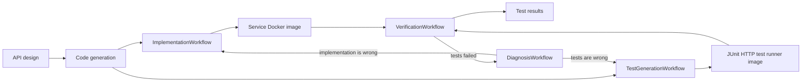

# Service implementation, tests and verification workers

The pipeline is API design → code generation → parallel implementation and test generation
→ verification against the running service.
New API-design sessions automatically start `ImplementationWorkflow` and
`TestGenerationWorkflow` on separate task queues after successful code generation.
Both children start before either is awaited to completion. Each result becomes
available independently; failure in one branch does not cancel the other. Replay
patches preserve the original behavior of existing histories. `VerificationWorkflow`
starts only after both authoring children succeed. Failed assertions are completed test
results, not workflow failures; failed builds skip verification. Failed tests start the
[repair loop](#automatic-repair-of-failed-tests): `DiagnosisWorkflow` decides whether the
implementation or the tests are wrong, that side's own workflow corrects it, and
verification runs again.



## Run

From `backend`, using the same environment/database settings as the existing workers:

```sh
python -m app.temporal.worker
python -m app.codegen.worker
python -m app.implementation.worker
python -m app.test_generation.worker
python -m app.verification.worker
python -m app.diagnosis.worker
```

Run each command in a separate terminal/process. `backend/tools/dev_stack.py` launches
all six workers, and `.zed/debug.json` includes individual worker launch profiles.
Both coding workers need the Docker CLI, a running Docker daemon and writable
`GENERATED_CODE_DIR`. The implementation worker also needs access to codegen's server
tree. The test worker uses only contract inputs and its own static Maven template.
The verification worker also needs Docker and writable `GENERATED_CODE_DIR`, and must
use the same Docker daemon as both authoring workers: images are local immutable IDs,
not registry tags. `TEMPORAL_VERIFICATION_TASK_QUEUE` defaults to `verification`.
The diagnosis worker has the same Docker and `GENERATED_CODE_DIR` needs as the coding
workers and reads the published service, test suite and verification artifacts.
`TEMPORAL_DIAGNOSIS_TASK_QUEUE` defaults to `diagnosis`.

Configure `OPENAI_API_KEY`, `OPENAI_MODEL`, and `OPENAI_BASE_URL` through the environment.
Loopback provider URLs are translated to `host.docker.internal` inside Docker; remote
URLs are preserved. `TEMPORAL_IMPLEMENTATION_TASK_QUEUE` defaults to `implementation`
and `TEMPORAL_TEST_GENERATION_TASK_QUEUE` defaults to `test-generation`. The containers
require outbound access to the LLM provider and Maven repositories.

Setting `LLM_HARNESS=pi` routes model calls through the Pi CLI instead: the host chat
uses the `pi` on its `PATH`, and the coding-agent image installs its own. Pi signs in with
the credentials in `PI_CREDENTIALS_DIR` (default: Pi's own `PI_CODING_AGENT_DIR`, else
`~/.pi/agent`). Host calls run Pi with that directory as its configuration directory, and
each coding container gets
that directory's `auth.json` mounted read-write, so a refreshed token is kept, and its
`models.json` read-only, inside a `containers/` subdirectory of it that all containers share
as their Pi directory. Pi locks `auth.json` through a lock directory beside it, so sharing
that directory lets parallel agents take turns refreshing an OAuth token instead of each
rotating it. `PI_MODEL` selects the model; without it containers use the
default model named in the directory's `settings.json`.

Setting `LLM_HARNESS=claude` routes model calls through Claude Code instead, driven by the
Claude Agent SDK (`app/llm/claude.py`). The `claude-agent-sdk` package bundles the CLI, so
neither the host nor the coding-agent image installs anything else. Each model call is one
Claude Code process making one request: its built-in tools, settings, skills and project
context files are switched off, the application's tools are declared to it as an
in-process MCP server, and the turn limit hands every tool call back to LangGraph or the
coding-agent loop to run. Earlier messages are resumed as a native session transcript.
Claude Code still adds its own short environment notes to each request, and a conversation
that ends in tool results is resumed with a `Continue.` prompt, because Claude Code only
starts a turn from a user message. `CLAUDE_MODEL` selects the model; without it Claude
Code uses its default. On the host Claude Code signs in with its own login, or with
`ANTHROPIC_API_KEY` / `CLAUDE_CODE_OAUTH_TOKEN` (from `claude setup-token`) when set. A
host login lives in the keychain or `~/.claude` and is not shared with containers: coding
agents require one of those variables (or `ANTHROPIC_AUTH_TOKEN`), which is forwarded by
name along with `ANTHROPIC_BASE_URL`.

## Langfuse tracing

See [Langfuse tracing](langfuse-tracing.md) for environment setup, privacy controls,
trace/session structure and the live smoke/audit command. Chat and design turns,
coding-agent generations/tools, codegen and verification are instrumented.
`backend/.env` is loaded for local development and never copied into agent images.

## Docker diagnostics

Worker logs now report Docker operation start/end, an operation ID, elapsed time and
exit status (including timeout/cancellation). Arguments and environment values are
not logged because they may contain credentials. Failure output tails are logged at
ERROR; successful output tails are available with `LOG_LEVEL=DEBUG`. Known provider
and environment secrets are redacted before output is returned, persisted or logged.

Each authoring stage preserves bounded Docker build output in its artifact directory:

- `agent-build.log`: building the authoring/toolchain image;
- `image-build.log`: building the generated service or test-runner image;
- `agent.log`: authoring container output, including provider errors.

Build logs are saved on success, failure, timeout and cancellation. Verification logs
also identify session/container/network names and report collection/result summaries.
These are diagnostics, not an automatic retry or repair mechanism. The UI's test-stage
failure label covers generation **or** build failure: provider rejection, connectivity
and agent termination can fail the stage before compilation. Inspect `agent.log` first
in that case. A host-side image build failure is not fed back into the completed coding
agent, and automatic Temporal/model retries remain disabled.

## Shared execution machinery

`backend/app/agent_workflows/` contains the reusable execution machinery:

- `host.py`: `StageSpec`, `StageInputs`, regular-file copying, and `run_stage` for
  prepare → isolated authoring → sanitize/validate → image build → publish.
- `runtime.py`: `AgentProfile`, workspace tools, and the bounded synchronous tool loop.
  It has no Temporal, database, Docker, or host-config imports.
- `workflows.py` and `worker.py`: deterministic activity execution and dedicated worker
  bootstrap, used by the existing named workflows and worker entrypoints.
- `Dockerfile`: today's shared Java 21/Maven default. The role entrypoint and workspace
  are selected through `AGENT_ROLE` and `WORKSPACE_NAME` build arguments.

Provider construction lives in the pure `app/llm/factory.py`. Host `get_model()` retains
its cached configuration wrapper; containers pass their environment settings explicitly.
Prompts, input visibility, completion checks, and output policies remain role-local.
The generic lifecycle does not assume Maven, Java filenames, or access to sibling artifacts.

Default images build from `backend/`, not a role directory:

```sh
# From backend/
docker build -f app/agent_workflows/Dockerfile \
  --build-arg AGENT_ROLE=implementation --build-arg WORKSPACE_NAME=service \
  -t temporal-implementation-agent:local .
docker build -f app/agent_workflows/Dockerfile \
  --build-arg AGENT_ROLE=test_generation --build-arg WORKSPACE_NAME=tests \
  -t temporal-test-generation-agent:local .
```

The workers perform these builds automatically. `backend/.dockerignore` is a strict
allowlist: only the pure runtime/factory, empty package initializers, and role entrypoints
are build inputs. Each image copies only its selected entrypoint. Generated data, secrets,
host orchestration/config, and the other role's code are not copied into an agent image.

## Implementation

The host worker builds the shared default with `AGENT_ROLE=implementation` and
`WORKSPACE_NAME=service`, then creates a constrained, non-root container with Python,
Maven and Java 21. Requirements, the requirements
document and structured API design are supplied in `/workspace/input.json`. When the
document's tables exactly render the structured requirements, only its narrative is
supplied (`requirements_narrative`); any other document is passed whole. Generated
sources are copied to `/workspace/service`, excluding tests, symlinks and build output.
Original codegen sources and tests remain untouched.

The container's bounded LLM tool loop can list, search, read ranges of, write and
exactly edit workspace files, and execute shell commands. Long command output is saved
under `.agent-output/` in the workspace and returned as its diagnostic lines and tail;
that directory is never published.

The loop keeps its context inside `AGENT_CONTEXT_TOKENS` (default 64000; set it to the
model's context window, `0` disables). Usage reported by the provider is used when
available, otherwise a character-based estimate. Past 75% of the budget, the oldest
complete assistant/tool-result batches are replaced by one checkpoint message: the files
written or edited so far, plus decisions, completed and remaining work and unresolved
errors summarized by an extra `compact-history` model call. The system prompt, the
supplied contracts and the most recent batches (about 25% of the budget, always at
least the latest) are kept verbatim; current code is re-read from disk. The setting is
forwarded from the worker's environment to both coding containers.

Contracts whose embedded form exceeds `CONTRACT_EMBED_CHARS` (default 60000 characters)
are supplied on demand instead. `/workspace/input.json` then holds an index of every
requirement (ID, category, priority, title), endpoint (operation, summary, requirement
IDs) and schema name, and the complete documents are written to `/workspace/contracts/`
(`requirements.json`, `openapi.yaml`, and `requirements.md` when there is a narrative or
unrecognised document). The agent gets two extra read-only tools, `read_contract` and
`search_contracts`, confined to that directory, which lies outside the published
project. Smaller contracts are embedded exactly as described here.

It implements the service and writes its production `Dockerfile` and `.dockerignore`.
The host retrieves sources, excludes tests/build output again, and builds that Dockerfile.
Only a successful build publishes:

- `<GENERATED_CODE_DIR>/<session-id>/implementation/service/`: implemented sources;
- `<GENERATED_CODE_DIR>/<session-id>/implementation/image.json`: service image ID,
  source path and session ID;
- `<GENERATED_CODE_DIR>/<session-id>/implementation/agent.log`: bounded, API-key-redacted
  agent output, captured before container removal, including failed runs.

The same result is available through `ApiDesignWorkflow.get_state().implementation`.
Failures set `implementation_error`.

## Independent test generation

The test worker builds the shared default with `AGENT_ROLE=test_generation` and
`WORKSPACE_NAME=tests`, then creates its own constrained, non-root container with
Python, Maven and Java 21. Its only session inputs
are requirements and the requirements document (reduced to its narrative as above) in
`/workspace/input.json`, plus OpenAPI YAML rendered from the structured API design in
`/workspace/openapi.yaml`. The structured design itself is not repeated. Extra context
fields are discarded. History compaction and on-demand contracts work as for the
implementation agent; on demand, the OpenAPI document is `/workspace/contracts/openapi.yaml`
and is no longer embedded.

`/workspace/tests` starts from a static Maven/JUnit 5 template. No generated server
sources, implementation sources, implementation image, logs, or test stubs are copied
into this container. Neither coding container has a Docker socket or host mounts (other
than the Pi credential files under `LLM_HARNESS=pi`), and
their filesystems are separate. Source isolation is enforced by the supplied filesystem
and inputs as well as the agent instructions.

The test agent writes HTTP tests with Java's `HttpClient`, JUnit assertions and Jackson,
using only documented API behavior and business requirements. It uses `SERVICE_BASE_URL`
to address a running service and reads any required credentials from environment
variables documented in the suite's README. It compiles tests during authoring without
running service requests; the implementation may still be in progress.

The host retrieves regular test files and Maven/README configuration, excludes
symlinks, production sources and build output, and supplies its own runner Dockerfile
and `.dockerignore`. Building the runner independently compiles the suite with
`mvn -B -DskipTests -Dmaven.test.skip=false test-compile`. Only a successful build publishes:

- `<GENERATED_CODE_DIR>/<session-id>/tests/suite/`: standalone Maven test project;
- `<GENERATED_CODE_DIR>/<session-id>/tests/image.json`: test runner image ID, suite path
  and session ID;
- `<GENERATED_CODE_DIR>/<session-id>/tests/agent.log`: bounded, API-key-redacted agent
  output, including failed runs.

The result is available through `ApiDesignWorkflow.get_state().tests` and the existing
session GET endpoint. Failures set `tests_error`. Requirements, API documents, codegen
output and the successful sibling result remain available. Both activities heartbeat,
have bounded execution times and disable automatic retries to avoid repeated model
calls. Agent containers are removed on success, failure or cancellation.

### Retry failed generation

The API-design page offers **Retry server generation** and **Retry test generation**
next to a failed stage. Wait for the current pipeline to finish before retrying.
The corresponding API is `POST /api/api-design/sessions/{session_id}/generation/retry`
with `{"stage": "server"}`, `{"stage": "tests"}` or, after a failed push,
`{"stage": "repository"}`. Invalid or successful stages
cannot be restarted; attempts while generation is active return HTTP 409.

A retry starts a fresh `ApiDesignWorkflow` run under the same session ID, preserving
its conversation, requirements, OpenAPI document and successful sibling artifacts.
Server retries rerun implementation/build, or codegen followed by both authoring
branches if codegen itself failed. Test retries rerun only test generation/build.
Each retried child gets a run-specific ID. Verification resumes automatically once
both images are available; repeated failures remain manually retryable. This is a
fresh authoring attempt from the original inputs, not repair using failure logs.

## Working in the repository

A session's repository is checked out to `<GENERATED_CODE_DIR>/<session-id>/repository`
before its first model turn (see [GitHub connector](github-connector.md#checkout-and-push)),
and both authors work inside it. Containers still receive copies, never host mounts:

- **Implementation.** `/workspace/service` is the checkout without Git metadata, tests,
  build output or `contract-tests/`, with the generated server tree added: generated files
  under `src/` (the API contract) replace the repository's, any other generated file only
  fills a gap, so an existing `pom.xml` or `README.md` is kept. The published
  `implementation/service` is therefore the whole repository tree as the author left it.
- **Tests.** `/workspace/tests` starts from the template plus the repository's existing
  `contract-tests/` sources, if any. The rest of the repository, including any
  implementation in it, stays out of the test author's workspace.
- **Repairs and diagnosis** continue from the published trees as before.

The checkout itself is untouched until verification passes. Then the main worker makes the
files the implementation author could see equal to `implementation/service` (files it
removed are deleted; tests it never saw stay), replaces `contract-tests/` with
`tests/suite`, commits and pushes the new `generated/…` branch.
`ApiDesignWorkflow.get_state()` reports `publication_status` (`waiting`, `running`,
`completed`, `skipped` when verification did not pass, `error`), `publication` and
`publication_error`.

## Add a future stage

1. Define explicit policies in the new role's host module. `prepare_inputs(session_dir,
   context)` validates prerequisites before artifact creation and returns `StageInputs`:
   `context` is the only JSON payload sent to the agent, and `populate(workspace)` copies
   only approved files. Sanitization and validation hooks own the permitted build outputs.
2. Define the container-only `agent.py` using `AgentProfile` and `runtime.run_agent`.
   Supply its root, prompt, initial messages, turn-limit environment key, and completion
   check/messages. Keep host imports out of this file. The current entrypoints are examples.
3. Configure a `StageSpec` with unique role/artifact names. For the Java default, use
   `default_agent_image(role, workspace_name)` and explicitly allow the new role's directory
   and `agent.py` in `.dockerignore`. For another toolchain, supply `AgentImageBuild` with
   its context, Dockerfile, and optional build arguments. Custom images must support UID
   10001, a writable `/workspace`, provider environment variables, and the selected output
   tree at `/workspace/<workspace_name>`; no Java/Maven assumptions are required.
4. Add a thin decorated activity calling `run_stage(spec, session_id, context,
   GENERATED_CODE_DIR)`, a named workflow using `execute_agent_activity`, and a worker
   entrypoint using `run_agent_worker`. Register/schedule the new stage explicitly.
   Specs/callbacks are host-side definitions, never Temporal input payloads.

For a variant that intentionally retains implementation's input/output policies:

```python
from dataclasses import replace

from temporalio import activity

from app.agent_workflows.host import run_stage
from app.config import GENERATED_CODE_DIR
from app.docker_agents import default_agent_image
from app.implementation.activities import STAGE

VARIANT = replace(
    STAGE, role='implementation_variant', artifact_subdir='implementation-variant',
    image_build=default_agent_image('implementation_variant', 'service'),
)

@activity.defn
async def implement_variant(session_id: str, context: dict) -> dict:
    return await run_stage(VARIANT, session_id, context, GENERATED_CODE_DIR)
```

This needs its own allowlisted `implementation_variant/agent.py` and named workflow/worker,
not changes to the execution engines. A later revision stage can replace `prepare_inputs`
to seed a prior implementation and explicitly filter feedback. Never automatically give
an independent test-authoring stage implementation sources/images/logs. Feedback/retry
using failure logs is not implemented here; manual retries use the original inputs,
and initial authoring branches remain parallel.

## Automatic verification

New sessions automatically start verification once the implementation and independent
test suite have both built successfully. No images are rebuilt. The worker creates one
unique bridge network and exactly two containers: the service (network alias `service`)
and its test runner. Both use resource limits, dropped capabilities and declared non-root
image users. There are no host mounts, Docker sockets, published ports or inherited
worker credentials. Images declaring root/no user are rejected. Outbound access remains
available for Maven dependencies.

The trusted runner waits at most two minutes for TCP readiness at `service:8080` (not an
assumed health endpoint), then runs Maven for at most ten minutes with
`SERVICE_BASE_URL=http://service:8080`. The service must be self-contained; external
databases and environment/credential configuration are not supported in this step. The activity heartbeats, has a fifteen-minute execution limit and does not
automatically retry. Cancellation propagates; normal completion, failures and
cancellation all attempt bounded removal of both containers and their network.

The verification child returns a summary with:

- `status`: `passed`, `failed` (assertions/JUnit errors), or `error` (infrastructure);
- `tests`, `passed`, `failures`, `errors`, `skipped`, total `duration_seconds`, and runner
  `exit_code`;
- up to 50 failed/error-test details (class/name, kind and a bounded message), with
  `details_truncated` when more failures exist;
- bounded service/runner log tails (up to 200 lines/8,000 characters each), an optional
  infrastructure `error`, and artifact `path`.

A pass requires valid reports with executed tests, no failed/error tests, a successful
runner exit and a still-running service. Missing/malformed/linked/oversized reports,
all-skipped/zero tests, startup/test timeout, OOM or an unexplained nonzero exit are
infrastructure errors, not false passes. Report copying accepts only regular Surefire
`TEST-*.xml` files, bounds the tar stream to 8 MiB and each XML file to 1 MiB, and rejects
XML DTD/entity declarations. Counts come from testcases, not duplicate suite counters.

Artifacts live in `<GENERATED_CODE_DIR>/<session-id>/verification/<run-id>/` (`reports/`,
container logs and `result.json`). The latest summary is atomically published as
`verification/result.json` and exposed as `ApiDesignWorkflow.get_state().verification`
and through the existing session GET endpoint. `verification_status` distinguishes
waiting, running, completed, skipped, error and legacy not-applicable sessions;
`verification_error` records unexpected child-workflow failures. Returned test results
(including assertion failures/infrastructure errors) are completed verification steps.
The parent still returns its OpenAPI document and retains all successful build artifacts.

The API-design page keeps polling through verification, shows pass/fail/error counts,
failed-test details and expandable container logs. Older histories replay without the
new child and are not retroactively verified.

## Automatic repair of failed tests

When verification completes with `status: failed`, the parent runs repair rounds until
verification passes. Each round is:

1. **Diagnosis** (`verification_status: diagnosing`). `DiagnosisWorkflow` runs a reviewing
   agent in the same isolated container setup as the coding agents. Its workspace holds
   the published implementation (`service/`), the published test suite (`tests/`), the
   failed run (`verification/`: Surefire reports and both container logs) and the
   requirements and API design, embedded or on demand like the coding stages. The contract
   is the only authority. The agent writes `verdict.json` with `target`
   (`implementation` or `tests`), a `summary` and self-contained repair `instructions`.
   The host accepts only a bounded, well-formed verdict and publishes it as
   `<GENERATED_CODE_DIR>/<session-id>/diagnosis/verdict.json`.
2. **Repair** (`verification_status: repairing`). The blamed side's own workflow
   (`ImplementationWorkflow` or `TestGenerationWorkflow`) runs again with a `repair` entry
   in its context: the instructions, up to 30 clipped failing-test details and, for the
   implementation only, the service log tail. The agent continues from its previously
   published output rather than starting over, and the stage rebuilds and republishes its
   image as usual. Source isolation is kept: neither author receives the other's sources.
3. **Verification** of the current images.

`ApiDesignWorkflow.get_state().repairs` lists each round's `attempt`, `target` and
`summary`, and the page shows them. The loop stops when verification passes, or without
passing when:

- verification ends with an infrastructure `error` rather than failed tests;
- diagnosis fails (`verification_error` is set);
- the repair stage fails: the previous image stays published, the stage's error is
  recorded and the existing manual retry for that stage is offered;
- `MAX_REPAIR_ROUNDS` (5, in `app/temporal/workflows.py`) rounds did not produce a pass
  (`verification_error` is set and the last failed result is kept).

Histories from before the `verification-repair-loop` patch end with their first
verification, as before.

To exercise real Docker networking, the trusted runner and Surefire collection without
an LLM, run from `backend`:

```sh
RUN_DOCKER_VERIFICATION_TESTS=1 python -m pytest tests/test_verification_docker.py -q
```

These opt-in tests build disposable HTTP service and Maven test images, cover passing,
failing, delayed and unavailable services, and verify resource cleanup. Normal backend
tests do not require Docker.

## Run the generated tests manually

Generation compiles the service and test suite; automatic verification executes them.
For manual execution, read the two `image_id` values from their manifests. On the
same Docker daemon, create a network and start the service image:

```sh
docker network create service-tests
docker run -d --name service --network service-tests SERVICE_IMAGE_ID
```

Wait for the service to be ready, then run the test image, supplying any credentials
documented by the suite:

```sh
docker run --rm --network service-tests \
  -e SERVICE_BASE_URL=http://service:8080 TEST_IMAGE_ID
```

The runner executes `mvn test`; assertion failures or no discovered tests produce a
nonzero exit status. Its Maven dependencies may require outbound access. Alternatively,
run `SERVICE_BASE_URL=http://localhost:8080 mvn -B test` in the published suite directory
with Java 21 and Maven installed. Images are not pushed or exported; another Docker
daemon needs an image registry or `docker save`/`docker load`.

## Trust boundary

No host directories or Docker socket are mounted into the coding container. Credentials
are provided at container creation, not baked into images. Under `LLM_HARNESS=pi` those
are the host's Pi `auth.json` (writable) and `models.json` as single-file mounts; the
agent can read the sign-in tokens and overwrite that one file. The agent can nevertheless
see its LLM key, execute arbitrary code and make outbound requests. Run this worker on
a dedicated Docker host for untrusted requirements/code. The generated service
Dockerfile is also executable build input; the build is not a sandbox for hostile code.
Do not use production credentials. Hard process/host failure can leave a container
behind; operators can remove containers named `implementation-*`, `test-generation-*`,
or `verification-*`. Verification networks also use `verification-*` names. Containers
and networks carry `temporal.verification=<session-id>` labels for identification:

```sh
docker ps -a --filter label=temporal.verification
docker network ls --filter label=temporal.verification
```

Only remove resources from inactive runs after checking their labels/session IDs. No
containers or networks are intentionally retained after verification.
